# Panduan Admin Kepegawaian

**SI CUTI — Kantor Pencarian dan Pertolongan Kelas B Nias**

Versi panduan **1.0** · **18 Oktober 2026 WIB**

Sumber aplikasi: `4c341b0b67bbeed0ea366fb22b3d369c47677b39`

Contoh lokal, data sintetis. Panduan penggunaan, **bukan kebijakan cuti baru atau bukti kesiapan produksi**.

Nama “Pegawai Contoh”, NIP berawalan nol, alamat, kontak, alasan, scan, dan penugasan pada gambar adalah data latihan. Bidang warna pada profil menggantikan foto; tidak memakai foto pegawai nyata. Gambar merupakan aplikasi yang benar-benar berjalan. Batas pembuktian ada pada [checkpoint](checkpoint-2026-10-18.md) dan [inventaris](inventaris-halaman.md).

## Daftar isi

1. [Akses dan ringkasan administrasi](#1-akses-dan-ringkasan-administrasi)
2. [Master Pegawai dan Arsip](#2-master-pegawai-dan-arsip)
3. [Akun, template dan impor Pegawai](#3-akun-template-dan-impor-pegawai)
4. [Saldo awal dan impor saldo](#4-saldo-awal-dan-impor-saldo)
5. [Atasan dan Pejabat Cuti](#5-atasan-dan-pejabat-cuti)
6. [Kalender hari libur dan Klaim Cuti Bersama](#6-kalender-hari-libur-dan-klaim-cuti-bersama)
7. [Pemeriksaan cuti/izin, arsip dan pengembalian](#7-pemeriksaan-cutiizin-arsip-dan-pengembalian)
8. [Laporan Cuti dan Izin](#8-laporan-cuti-dan-izin)
9. [Profil sendiri, bantuan dan glosarium](#9-profil-sendiri-bantuan-dan-glosarium)

## 1. Akses dan ringkasan administrasi

### 1.1 Masuk, berpindah menu dan keluar

**Tujuan/menu.** Login menggunakan akun Admin yang memang diberikan instansi. Siapkan NIP/kata sandi secara aman; akun dokumentasi pada gambar bukan akun yang boleh dipakai bersama.

1. Isi NIP dan kata sandi pada halaman masuk, tekan **Masuk**.
2. Gunakan **Dashboard & Kalender**, **Pegawai**, **Saldo Cuti**, **Pejabat Cuti**, **Laporan**, **Pengajuan**, atau **Klaim Cuti Bersama**. Avatar membuka profil sendiri.
3. Pada perangkat kecil buka/tutup menu. Dialog mendukung Tab/Shift+Tab dan Escape; konfirmasi paling atas ditutup terlebih dahulu.
4. Tekan **Keluar** setelah bekerja.

**Hasil.** Akun Admin membuka halaman Pegawai pada tujuan awal existing. **Jika login/akses gagal**, periksa kredensial dan status Employee/User/identity melalui pengelola yang berwenang. Admin berbeda tetap tidak dapat membuka hasil laporan milik Admin lain hanya dengan menyalin URL.

_Gambar 1. Form login kosong._

_Gambar 2. Penolakan login; password dikosongkan sebelum screenshot._

_Gambar 3. Logout kembali ke login, sesi berakhir._

Admin aplikasi tidak otomatis menjadi penandatangan atau memperoleh role Kepala Kantor/Atasan. Kewenangan dan dokumen keputusan tetap mengikuti kebijakan instansi. UI tidak menyediakan log login umum, reminder atau direktori foto pegawai lain.

### 1.2 Membaca dashboard, kalender dan agenda

**Tujuan/menu.** Buka **Dashboard & Kalender** untuk meninjau pengajuan. Siapkan periode, kategori, jenis/status dan pegawai yang ingin diperiksa.

1. Baca ringkasan tetap: pengajuan Cuti/Izin menunggu tinjauan dan pegawai unik dengan periode cuti disetujui yang mencakup hari ini (WIB).
2. Pilih kategori **Cuti** atau **Izin**, lalu filter periode/jenis/status/pegawai yang tersedia.
3. Pada kalender bulanan baca chip nama singkat + jenis/status. Maksimal tiga chip per sel; **+N lainnya** mengarah pada agenda tanggal tersebut.
4. Klik tanggal, baca agenda, lanjutkan halaman agenda jika perlu. Gunakan tombol perbarui bila memerlukan pembacaan terkini.

**Hasil.** Hitungan pengajuan, pegawai unik dan kemunculan pada tanggal adalah unit berbeda. Pengajuan lintas bulan dapat muncul pada kedua bulan, tetapi bukan dua permohonan. **Jika data kosong/error**, periksa filter atau Coba lagi; jangan menyebut personel “tersedia”/“siap gerak” dari kalender cuti.

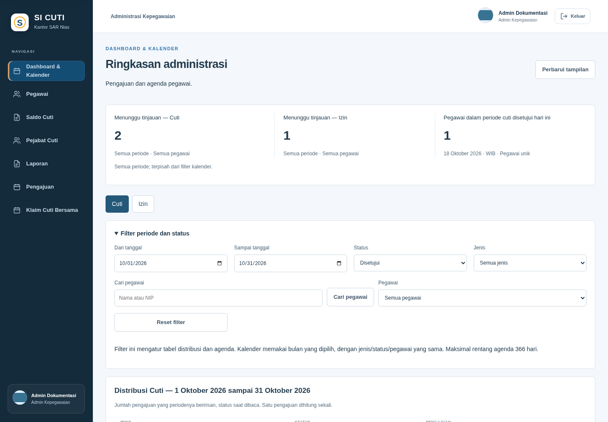

_Gambar 4. Ringkasan tetap, pending dan pegawai unik periode disetujui hari ini._

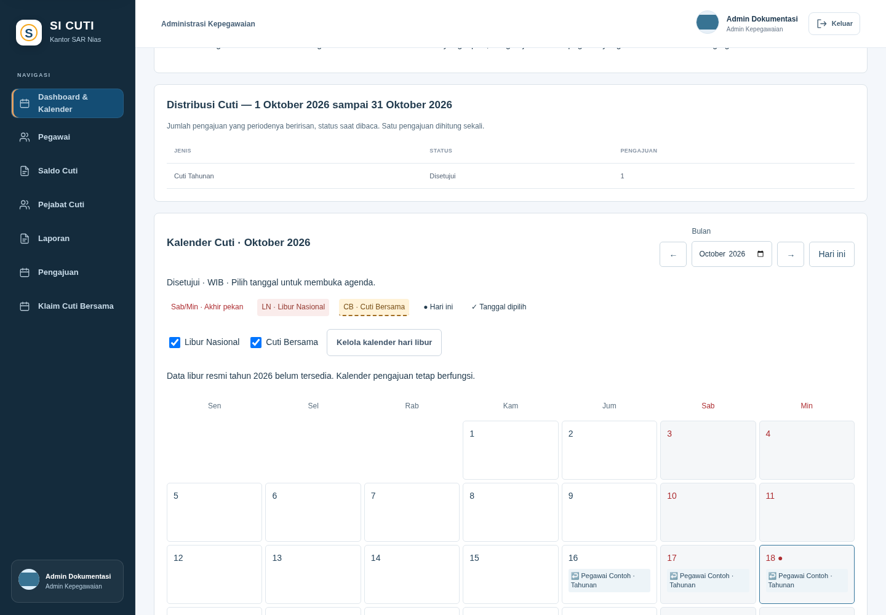

_Gambar 5. Chip nama dan kategori, weekend/legenda/agenda._

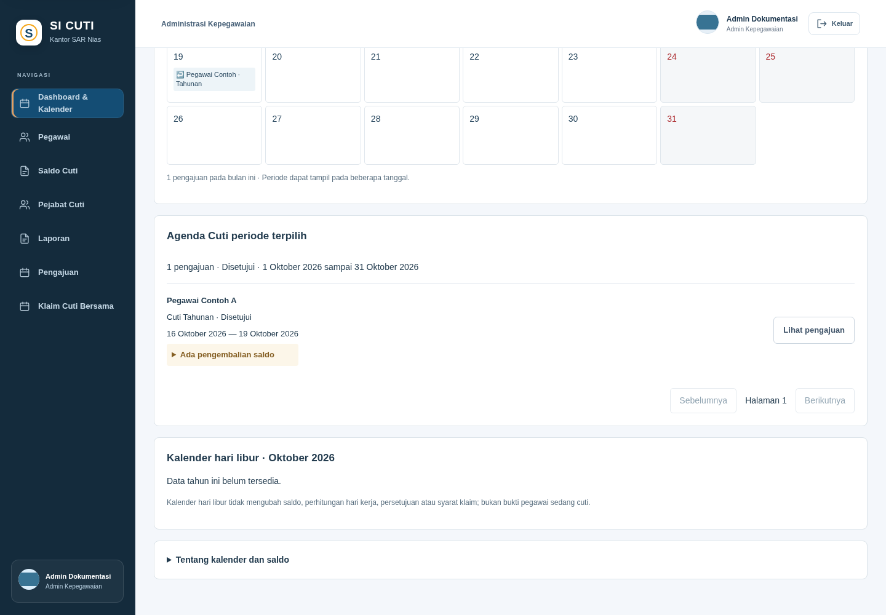

_Gambar 6. Agenda dan periode persetujuan, bukan penggunaan aktual._

Kartu tetap tidak mengikuti filter periode. Kalender memakai revisi yang sedang berlaku. Status/identitas chip adalah pembacaan saat ini, bukan seluruhnya snapshot arsip. Penanda pengembalian saldo mempertahankan periode persetujuan dan tidak menebak tanggal penggunaan aktual. Akhir pekan merah; LN/CB mempunyai legenda tersendiri bila overlay tersedia. Tanggal kosong bukan bukti kelayakan atau kelengkapan kalender kerja.

## 2. Master Pegawai dan Arsip

### 2.1 Mencari dan membuka detail

**Tujuan/menu.** Buka **Pegawai** untuk master administrasi. Siapkan nama/NIP atau unit yang dicari.

1. Default **Aktif**; pilih **Nonaktif (Arsip)** atau **Semua** untuk record lama.
2. Cari nama/NIP; pencarian existing juga mencakup jabatan/unit. Gunakan filter **Unit kerja** bila diperlukan.
3. Gunakan halaman berikut/sebelumnya; pagination lokal 10 baris dari daftar yang telah dimuat. Search/filter mereset ke halaman pertama.
4. Pilih **Lihat Detail** untuk identitas, atasan dan akun.

**Hasil.** Status Pegawai dan Status Akun Login ditampilkan terpisah. **Jika tidak ditemukan**, periksa filter Arsip/Semua sebelum membuat pegawai baru. Jika status akun gagal dimuat, ulangi pembacaannya; jangan menganggap akun belum ada.

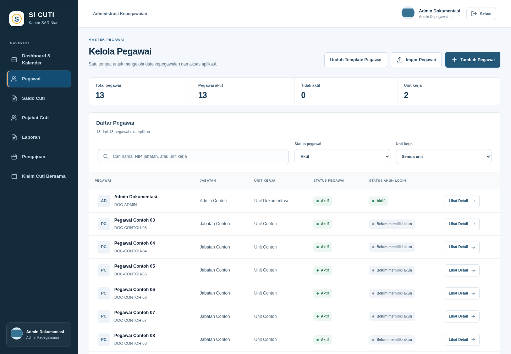

_Gambar 7. Daftar aktif, search/unit dan pagination lokal._

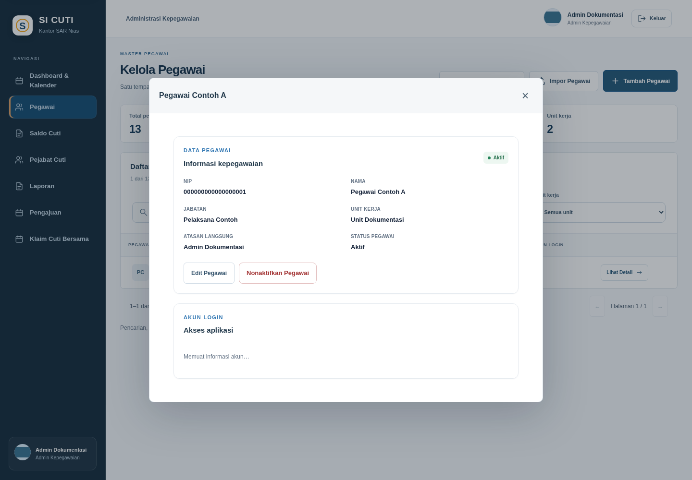

_Gambar 8. Status pegawai dan akun terpisah._

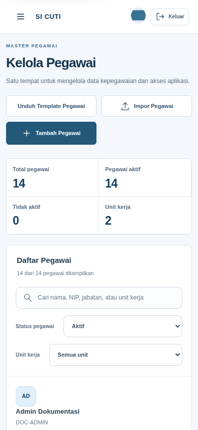

_Gambar 9. Kartu pegawai dan aksi ponsel._

### 2.2 Menambah dan mengedit master

**Tujuan/menu.** Gunakan **Tambah Pegawai** atau **Lihat Detail → Edit Pegawai**. Siapkan NIP unik, nama, jabatan, unit; tanggal mulai bekerja dan atasan langsung bila tersedia.

1. Isi NIP sebagai teks (maksimal 32 karakter); nama/jabatan/unit maksimal 200.
2. Pilih atasan yang benar; pegawai tidak boleh menjadi atasan dirinya sendiri.
3. Simpan sekali dan periksa hasil pada daftar/detail.
4. Jika mengedit, periksa ulang apakah orang lain telah mengubah master sejak form dibuka.

**Hasil.** Master tersimpan; NIP login LOCAL diselaraskan jika identity tersebut sudah ada. Tambah Pegawai **tidak sekaligus membuat akun atau saldo**. **Jika NIP duplikat**, cari record existing. Jika muncul konflik versi, tutup form, muat ulang halaman/daftar dan buka edit kembali; jangan menimpa perubahan orang lain tanpa pemeriksaan.

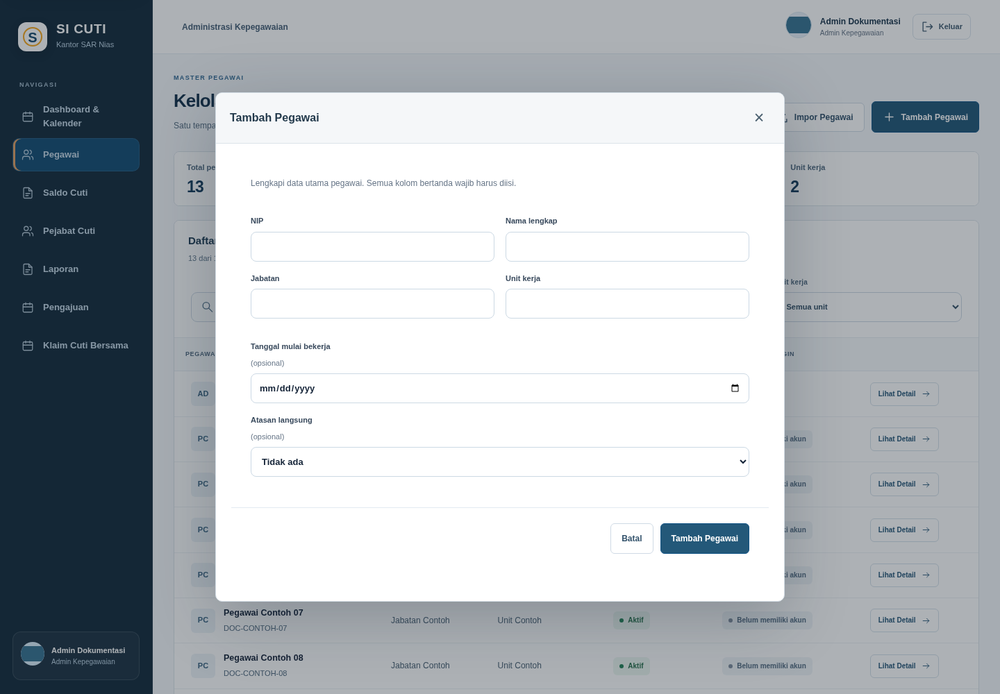

_Gambar 10. Tambah master tanpa saldo/akun._

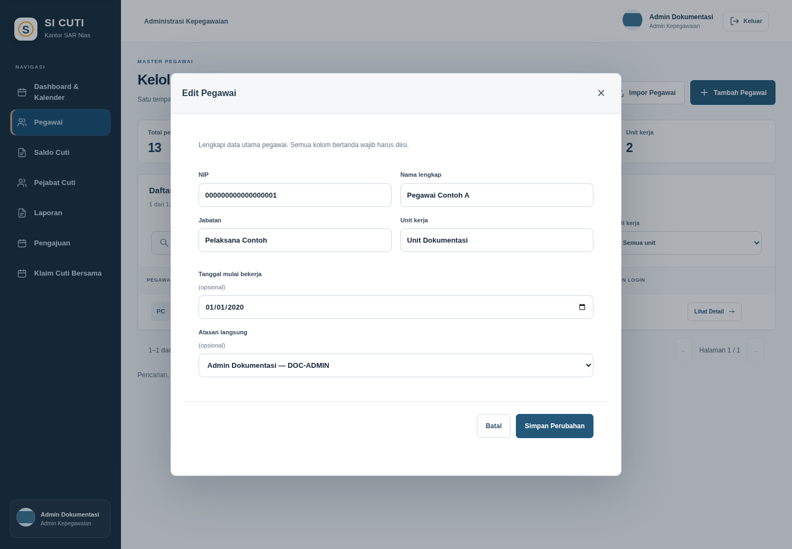

_Gambar 11. Edit master termasuk atasan langsung._

Edit master tidak mengubah snapshot pengajuan/dokumen historis. Relasi atasan adalah master existing, bukan assignment bertanggal efektif atau pemberian kewenangan approval baru.

### 2.3 Nonaktifkan, temukan di Arsip, aktifkan kembali

**Tujuan/menu.** Di detail gunakan **Nonaktifkan Pegawai** untuk menghentikan akses pegawai tanpa menghapus histori. Siapkan kepastian record dan dampaknya pada pemilik akun.

1. Baca nama/NIP dan konfirmasi dampak login/histori.
2. Pilih **Ya, nonaktifkan**. Sesi lama dicabut.
3. Cari record pada **Nonaktif (Arsip)** atau **Semua**.
4. Bila sesuai aturan instansi, pilih **Aktifkan Pegawai** lalu konfirmasi reaktivasi.

**Hasil.** Record, foreign key, saldo, pengajuan, dokumen dan audit dipertahankan. Arsip bukan hard delete/status domain baru. **Jika operasi ditolak**, perhatikan perlindungan Admin terakhir yang dapat login dan konflik data. Jangan memakai SQL/hard delete untuk mengakalinya.

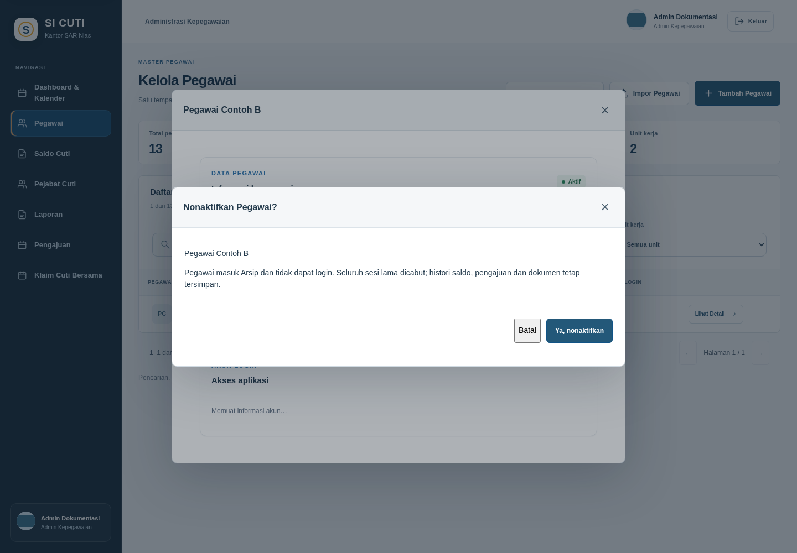

_Gambar 12. Konfirmasi dampak nonaktif dan sesi._

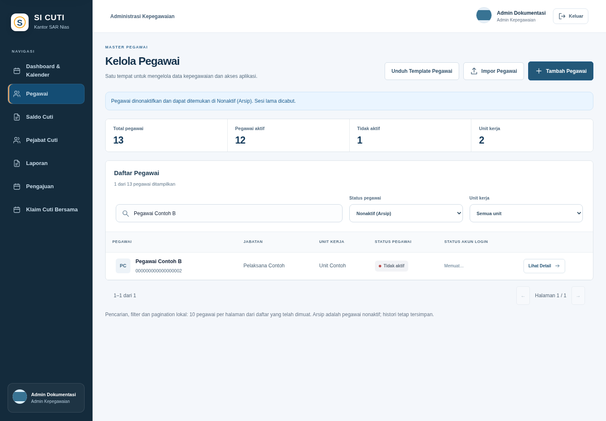

_Gambar 13. Arsip adalah filter pegawai nonaktif._

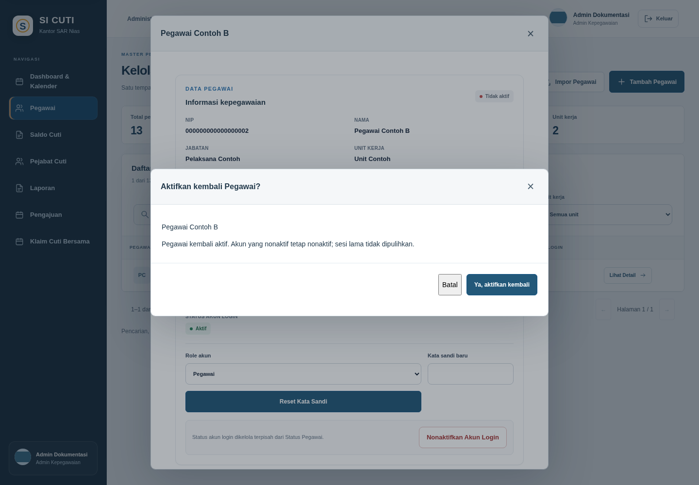

_Gambar 14. Reaktivasi tidak mengaktifkan akun nonaktif otomatis._

Reaktivasi Employee tidak otomatis mengaktifkan User/identity yang nonaktif, dan tidak memulihkan sesi lama. Pengguna yang kembali aktif tetap harus masuk baru.

## 3. Akun, template dan impor Pegawai

### 3.1 Provisioning, status akun, role dan reset LOCAL

**Tujuan/menu.** Buka **Pegawai → Lihat Detail → Akses aplikasi**. Siapkan keputusan akses yang sah dan mekanisme penyerahan kata sandi aman milik instansi; buku ini tidak menetapkan kanal baru.

1. Baca **Belum memiliki akun**, **Aktif** atau **Tidak aktif** berdasarkan hasil server.
2. Jika belum ada, isi role yang diizinkan (Pegawai/Admin Kepegawaian) dan kata sandi pada form, tekan **Buat Akun**.
3. Jika sudah ada, **Simpan Role** hanya untuk perubahan role yang memang diizinkan; status login dapat dinonaktifkan/diaktifkan terpisah.
4. Untuk reset, isi **Kata sandi baru** lalu **Reset Kata Sandi**. Hash lama tidak dapat dipulihkan.
5. Sesudah hasil berhasil, pastikan status akun sesuai. Jika mereset diri sendiri, masuk ulang karena semua sesi LOCAL terkait dicabut.

**Hasil.** Account/credential terpisah dari master Employee. **Jika memuat akun gagal**, gunakan retry; jangan membuat akun ganda. Jika respons operasi hilang, muat ulang status sebelum mengulang. Admin terakhir yang dapat login tidak boleh dinonaktifkan/didemosi melalui alur biasa.

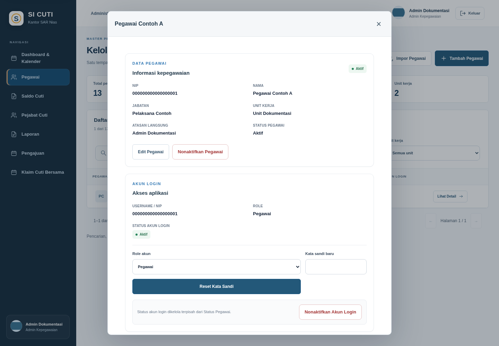

_Gambar 15. Provision/role/reset LOCAL existing; password kosong._

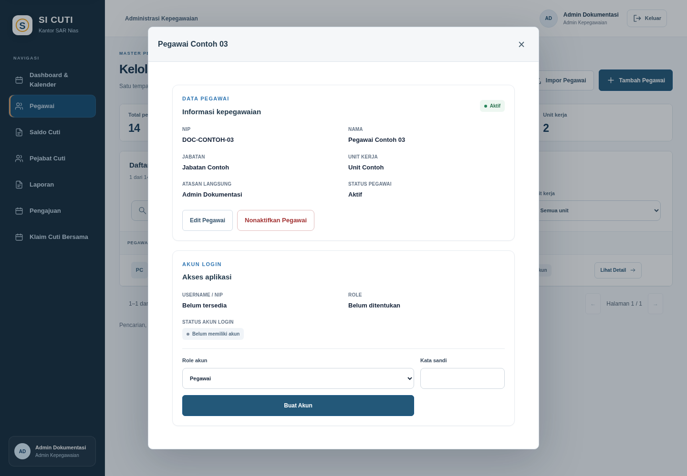

_Gambar 16. Master tanpa akun: form Buat akun dengan kata sandi kosong._

Jangan memasukkan password/hash/token ke file impor, screenshot atau log bantuan. Tidak ada reset email/telepon/lupa sandi mandiri pada baseline ini. Recovery darurat operator bukan menu Admin; ikuti runbook berwenang di luar panduan pengguna. Admin tidak dapat mengganti/melihat foto akun pegawai lain.

### 3.2 Template dan preview impor Pegawai

**Tujuan/menu.** Gunakan **Unduh Template Pegawai** dan **Impor Pegawai** di halaman Pegawai. Siapkan XLSX maksimal 2 MiB termasuk formulir unggahan dan maksimal 500 baris data.

1. Unduh template kosong. Worksheet pertama **Pegawai** berisi tepat lima kolom: **NIP, Nama Lengkap, Jabatan, Unit Kerja, Status Aktif**. Sheet **Petunjuk** bukan data impor.
2. Semua kolom wajib. Pertahankan NIP bertipe **Teks** sebelum mengetik/menempel agar digit panjang/nol awal terjaga. Jangan memakai formula, password, role atau kolom atasan tambahan.
3. Status menerima TRUE/AKTIF atau FALSE/TIDAK AKTIF. Baris seluruhnya kosong diabaikan.
4. Unggah dan tekan **Preview & Validasi**.
5. Baca nomor baris, NIP/nama, hasil dan kolom bermasalah. Gunakan halaman tabel; perbaiki file bila ada kesalahan.

**Hasil.** Preview **belum menulis database**. NIP numeric Excel yang mungkin sudah rusak, duplicate dalam file/DB dan field wajib kosong ditolak. **Jika invalid**, perbaiki sumber; jangan mengandalkan preview untuk memperbaiki digit yang telah dibulatkan Excel.

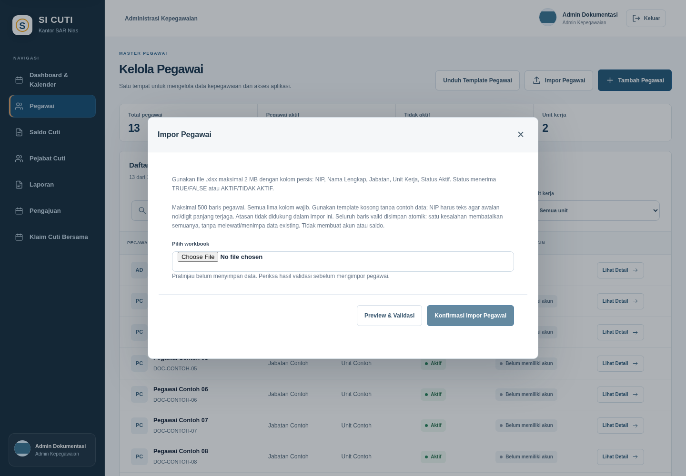

_Gambar 17. Impor pegawai terpisah dari saldo._

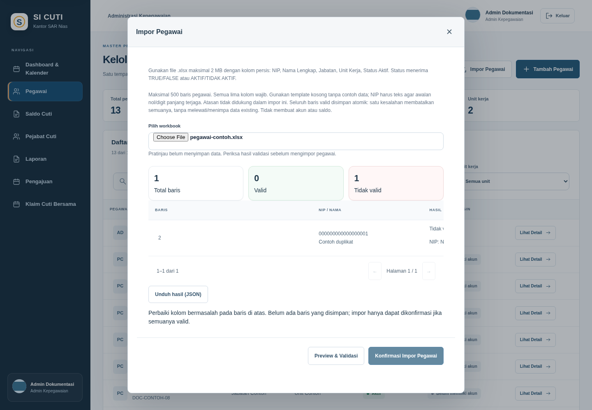

_Gambar 18. Baris invalid dan diagnosis, belum tersimpan._

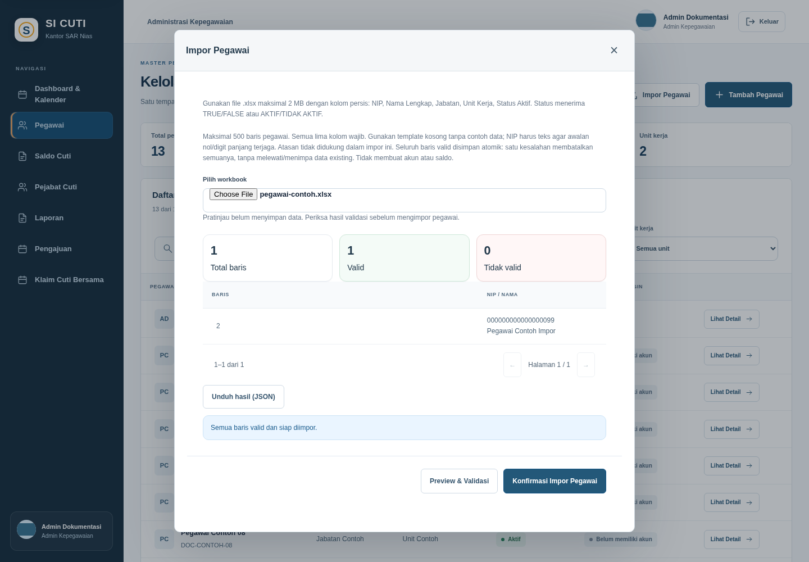

_Gambar 19. Preview valid sebelum konfirmasi._

Template tidak berisi pegawai contoh yang dapat terimpor tanpa sengaja. Pengaturan atasan dilakukan melalui edit satuan; impor tidak membuat akun/saldo.

### 3.3 Konfirmasi, hasil dan retry

**Tujuan/menu.** Tetap di dialog impor dengan preview valid. Siapkan file yang sama dan kepastian untuk menyimpan seluruh baris.

1. Tekan **Konfirmasi Impor Pegawai** satu kali.
2. Tunggu ringkasan berhasil/dilewati/gagal dan rincian per baris.
3. **Unduh hasil (JSON)** jika perlu menyimpan diagnosis/hasil; NIP di file tetap string. Tahap pratinjau, belum diketahui atau tersimpan dibedakan.
4. Bila koneksi terputus sesudah konfirmasi, jangan mengganti file/membuat impor baru. Gunakan **Coba konfirmasi lagi** dengan file/kunci yang sama pada tab tersebut.
5. Jika tab dimuat ulang/ditutup sehingga konteks retry hilang, periksa NIP pada daftar dan preview dahulu. NIP existing tidak akan ditimpa/diaktifkan kembali diam-diam.

**Hasil.** Impor Pegawai **atomik seluruh file**: satu kesalahan membatalkan semuanya. Sukses N berarti N berhasil/0 dilewati/0 gagal; tidak ada skip otomatis untuk pegawai existing. **Jika kegagalan validasi sudah pasti**, perbaiki dan buat preview ulang. Hasil tidak diketahui berbeda dari kegagalan pasti; UI mempertahankan file/kunci retry selama konteksnya masih ada.

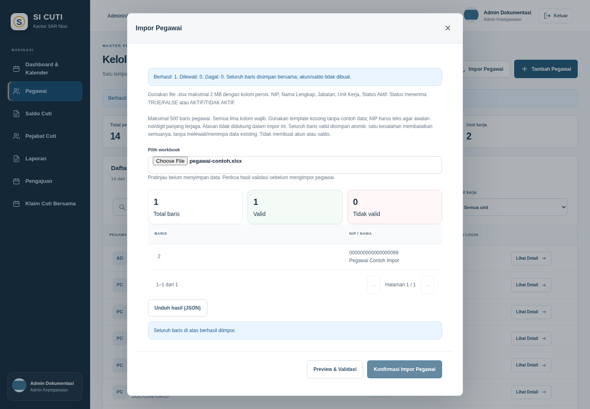

_Gambar 20. Sukses transaksi, rincian dan unduh JSON._

File hasil JSON bukan laporan resmi atau snapshot master terkini. Mulai unduhan tidak membuktikan file sudah tersimpan. Jangan mencampurkan template Pegawai dengan template Saldo.

## 4. Saldo awal dan impor saldo

### 4.1 Memeriksa dan menyiapkan saldo satuan

**Tujuan/menu.** Buka **Saldo Cuti**, pilih tahun dan pegawai. Siapkan dasar administrasi saldo yang sah, termasuk nilai N-1/N-2 sesuai riwayat.

1. Baca status **siap**, **belum diinisialisasi**, atau **perlu diperiksa/PARTIAL**. Cari nama/NIP dan status jika perlu.
2. **Lihat detail** untuk memeriksa setiap bucket dan nilai tersedia/cadangan/komitmen yang ditampilkan.
3. Hanya untuk saldo belum diinisialisasi, gunakan tindakan inisialisasi, isi nilai/dasar sesuai sumber yang sah dan simpan.
4. Periksa hasil dan status setelah selesai; jangan mengisi angka contoh buku sebagai hak pegawai.

**Hasil.** Layanan authoritative membuat saldo awal sesuai aturannya, bukan editor saldo bebas. **Jika PARTIAL/invariant bermasalah**, jangan menganggap nol atau mencoba overwrite; periksa melalui proses koreksi yang berwenang. Saldo siap tidak diinisialisasi ulang.

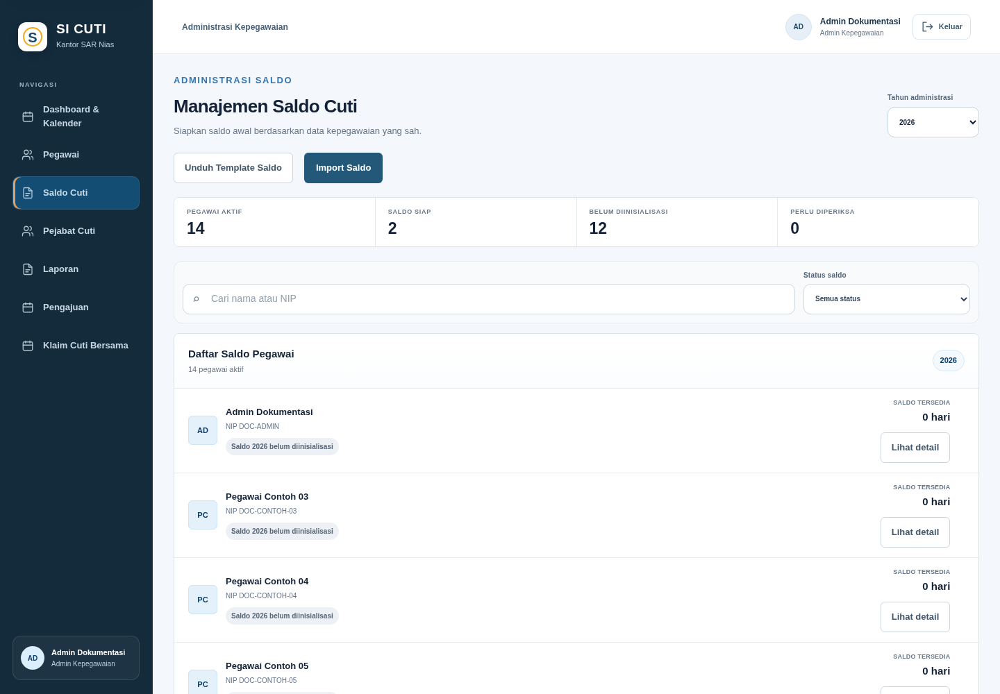

_Gambar 21. Saldo siap/belum/partial dan tahun administrasi._

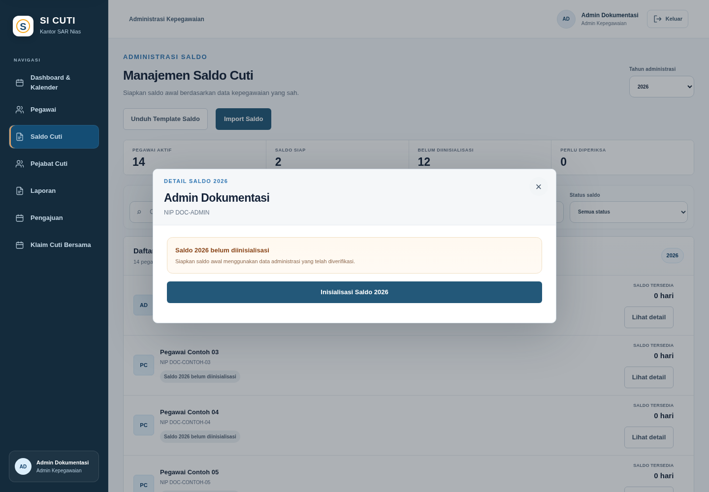

_Gambar 22. Detail bucket dan inisialisasi satuan._

### 4.2 Template, preview dan commit batch saldo

**Tujuan/menu.** Pada tahun administrasi terpilih gunakan **Unduh Template Saldo → Import Saldo**. Siapkan XLSX maksimal 2 MiB/1.000 baris, berbeda dari impor Pegawai.

1. Template saldo memuat **NIP, Nama Pegawai, Tahun, N, N-1, N-2, Cuti Bersama, Dasar Administrasi**.
2. Pertahankan tahun terpilih, N=12 dan Cuti Bersama=0 sebagaimana kontrak template existing. Isi N-1/N-2 dan dasar dari data sah, termasuk 0 bila memang sesuai; jangan menebak.
3. Unggah, tekan **Preview dan Validasi**. **Siap diproses/READY**, **Dilewati/SKIP**, **Error** mempunyai arti berbeda.
4. Periksa baris valid, centang konfirmasi, lalu **Konfirmasi dan Inisialisasi Saldo**.
5. Baca hasil per baris dan gunakan **Unduh Hasil Proses** bila diperlukan.

**Hasil.** Saldo lengkap existing dilewati, bukan ditimpa. PARTIAL tidak diperbaiki otomatis. Berbeda dengan impor Pegawai, batch saldo mempunyai **transaksi per pegawai/baris**: kegagalan satu baris tidak membatalkan baris lain yang berhasil. **Jika retry**, pertahankan file/tahun/preview/batch yang sama; baris yang sudah berhasil menjadi SKIP tanpa grant ganda. Jangan membuat batch baru untuk mengatasi hasil belum diketahui.

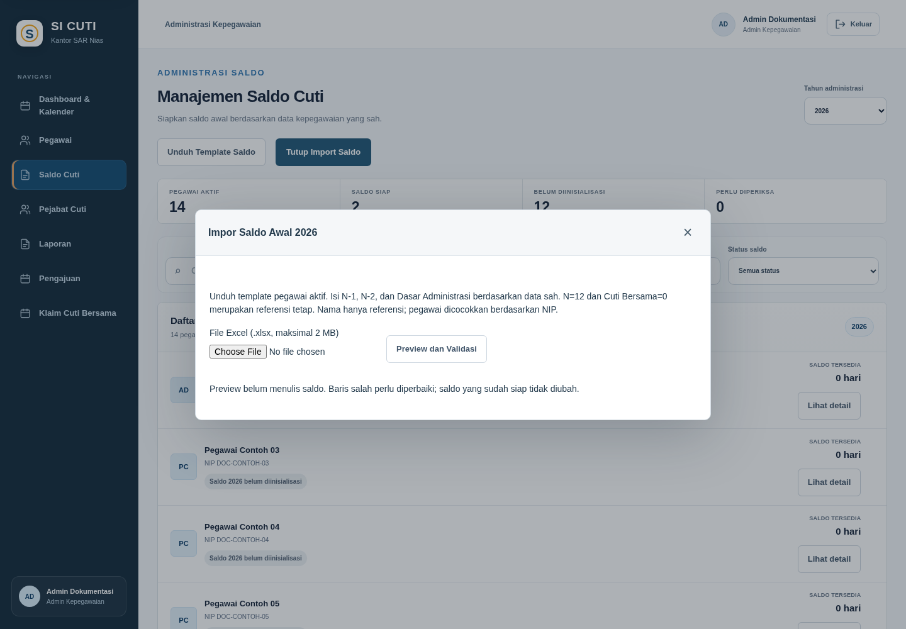

_Gambar 23. Template dan impor saldo berbeda dengan pegawai._

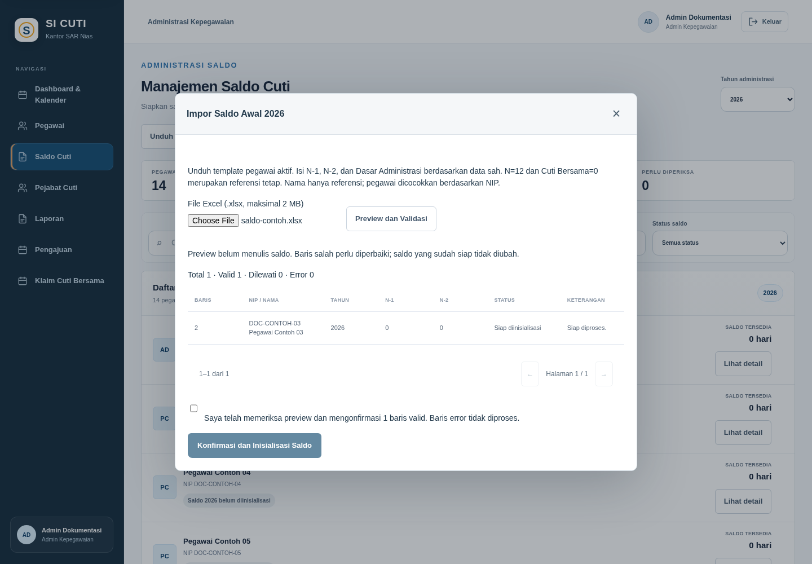

_Gambar 24. Ready/skip/error sebelum commit, terpisah dari impor pegawai._

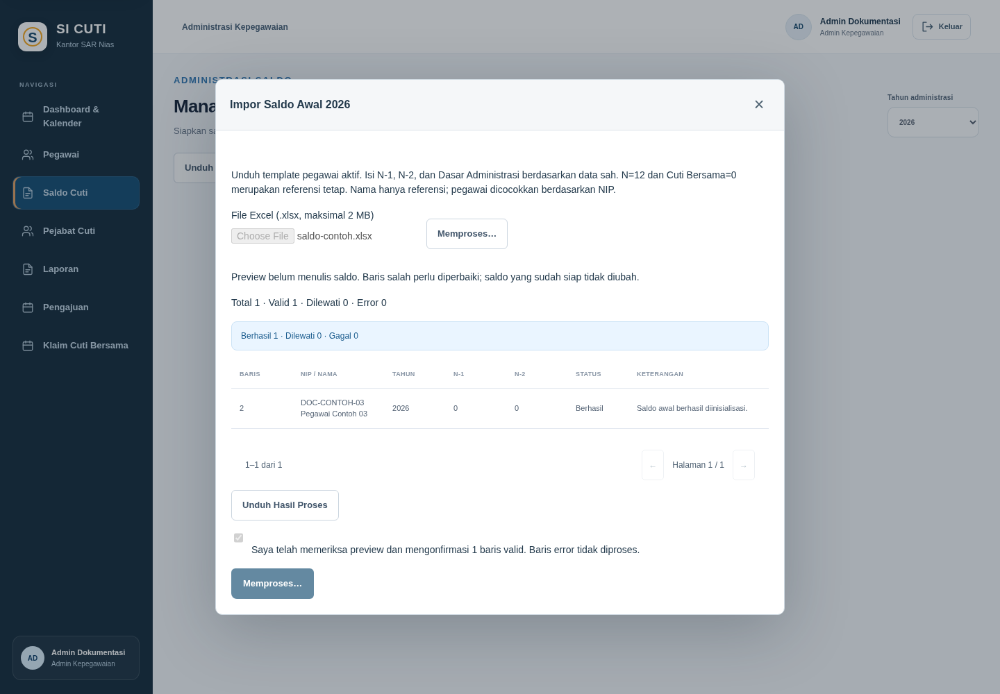

_Gambar 25. Hasil per baris, tidak menimpa saldo existing._

Klaim Cuti Bersama tidak diberikan melalui kolom Cuti Bersama template saldo awal. Tahun lama/rollover/hak N-2 mengikuti validator existing; buku ini tidak memperkenalkan aturan atau jalur edit saldo baru.

## 5. Atasan dan Pejabat Cuti

### 5.1 Atasan langsung dan penugasan pejabat

**Tujuan/menu.** Atasan langsung ada pada edit master Pegawai; Pejabat yang berwenang memberi cuti ada pada **Pejabat Cuti**. Siapkan nama, NIP, kapasitas Definitif/Plt./Plh., tanggal mulai/akhir dan referensi dasar.

1. Untuk atasan, pilih relasi pada Pegawai; jangan memilih dirinya sendiri.
2. Untuk pejabat, buka **Tambah penugasan**, isi identitas, kapasitas dan periode, simpan.
3. Baca status mendatang/aktif/berakhir dan gunakan **Ubah** sesuai batas yang diizinkan.
4. Buat penugasan baru untuk pergantian pejabat; jangan mengubah identitas historis untuk menyamarkan pergantian.

**Hasil.** Penugasan berlaku menurut periode, bukan role login baru. **Jika periode bertumpang tindih atau identitas historis terkunci**, periksa data/dasar, jangan membuat duplikat atau mengubah arsip lama.

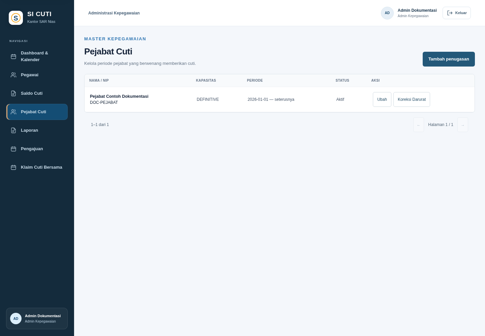

_Gambar 26. Pejabat efektif dan batas perubahan historis._

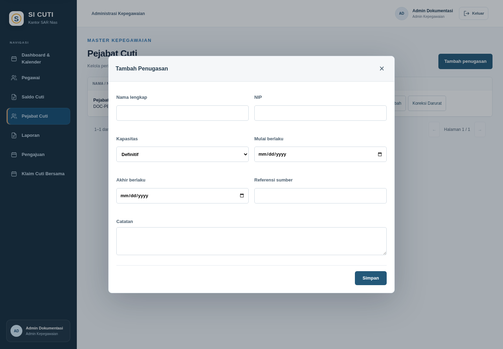

_Gambar 27. Tanggal kapasitas dan referensi penugasan._

### 5.2 Koreksi darurat dengan jejak audit

**Tujuan/menu.** **Koreksi Darurat** pada penugasan aktif/historis ditujukan bagi koreksi master yang berwenang, bukan penerbitan ulang dokumen. Siapkan field benar, alasan dan referensi dokumen sah.

1. Buka koreksi dan periksa nilai terkini serta riwayat.
2. Ubah field yang memang salah, isi alasan dan referensi.
3. Pilih **Tinjau perubahan**, periksa nilai sebelum/sesudah.
4. Hanya setelah dasar sah diperiksa, centang konfirmasi dan **Simpan Koreksi Darurat**.
5. Periksa riwayat; bila konflik, muat ulang dan tinjau lagi, jangan memaksakan form lama.

**Hasil menurut layanan/UI existing.** Koreksi master dan audit tercatat dengan versi; snapshot pengajuan, scan dan PDF historis **tidak diubah**. Buku mengambil screenshot form, tidak mengesahkan dasar contoh atau mengklaim penerbitan ulang otomatis. **Jika tujuan sebenarnya mengubah dokumen lama**, proses itu di luar tombol ini.

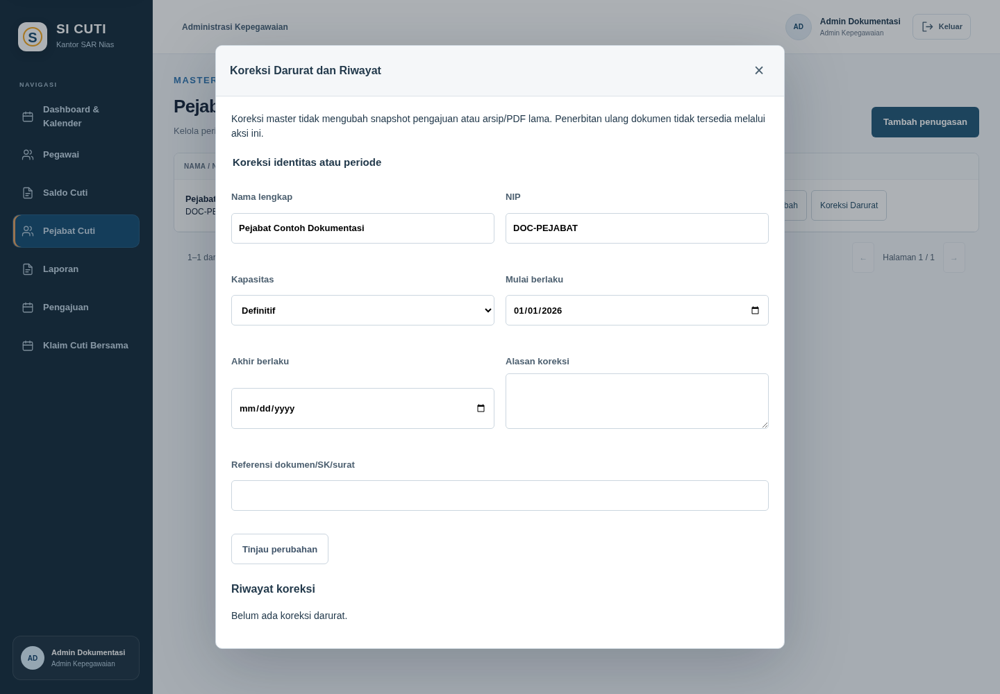

_Gambar 28. Alasan, referensi dan konfirmasi; snapshot lama tidak berubah._

## 6. Kalender hari libur dan Klaim Cuti Bersama

### 6.1 Input/import, preview dan publikasi overlay

**Tujuan/menu.** **Dashboard & Kalender → Kelola kalender hari libur** menambah lapisan tampilan LN/CB. Siapkan dokumen resmi beserta perubahan yang berlaku, referensi/tanggal dokumen dan dataset tahun yang sudah diverifikasi. Buku tidak menyediakan tanggal libur/kuota pemerintah yang ditebak.

1. Pilih tahun. Isi referensi, tanggal dokumen dan URL HTTPS pemerintah bila digunakan.
2. Isi tanggal/nama/kategori atau gunakan **Impor JSON resmi tervalidasi**. Format dapat dibuka di bantuan; LN dan CB adalah kategori berbeda, maksimal 500 event.
3. Pilih **Pratinjau overlay** dan periksa tambahan/perubahan/penghapusan serta versi.
4. **Jangan centang verifikasi dokumen resmi untuk data contoh.** Untuk dataset yang benar-benar sah, centang konfirmasi setelah pemeriksaan, lalu **Terbitkan overlay**.
5. Lihat riwayat/versi. Jika versi berubah saat bekerja, kembali ke form dan buat preview ulang; jangan menimpa perubahan pihak lain.

**Hasil.** Publikasi menambah versi tampilan, bukan mengubah WorkingCalendarException, perhitungan hari kerja, saldo, approval atau eligibility klaim. **Jika tahun belum tersedia**, kalender pengajuan tetap berfungsi. Jika JSON ditolak, periksa tahun event, tanggal/kategori duplikat, field dan sumber; tidak ada parser PDF generik atau konektor pemerintah otomatis.

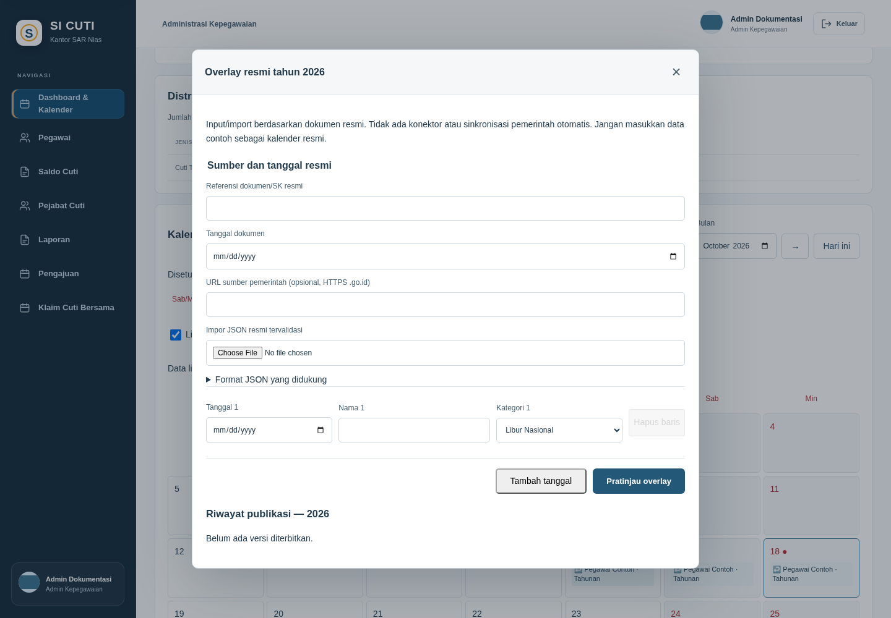

_Gambar 29. Input/import dan riwayat kosong, belum ada dataset resmi._

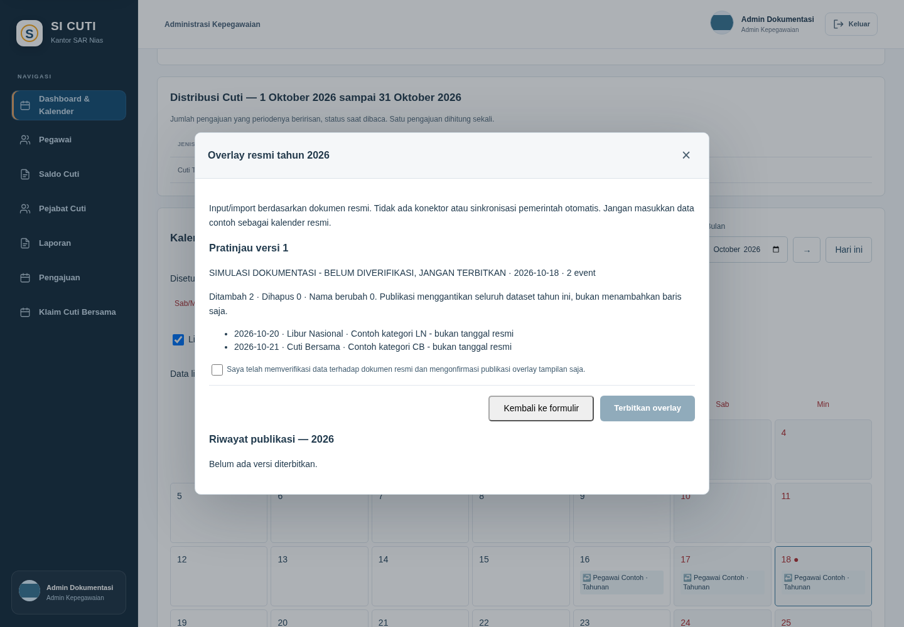

_Gambar 30. Pratinjau simulasi saja; checkbox verifikasi tidak dicentang._

**Batas screenshot.** Preview contoh berlabel “SIMULASI … JANGAN TERBITKAN” tidak dipublikasikan. PDF/nomor/perubahan SKB resmi belum terverifikasi pada checkpoint sumber. Buku ini tidak menunjukkan publikasi/riwayat resmi terisi sebagai alur yang sudah diuji. Jangan menyalin tanggal preview ke lingkungan instansi.

### 6.2 Pengaturan tanggal klaim dan pemeriksaan klaim

**Batas saat buku dibuat.** Menu/komponen tersedia, tetapi endpoint statis koleksi/kebijakan Klaim mengembalikan HTTP 500 pada lokal. Gambar merekam error aktual dan form konfigurasi, bukan hasil sukses. Jangan menganggap konfigurasi/klaim tersimpan ketika hanya formnya terbuka.

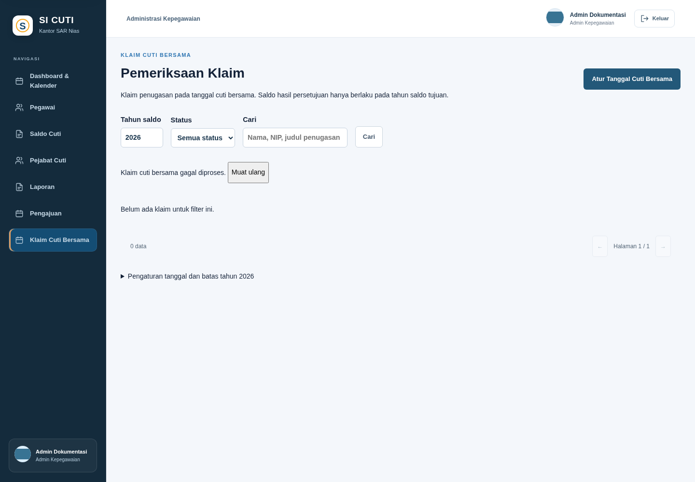

_Gambar 31. Respons aktual daftar klaim HTTP500._

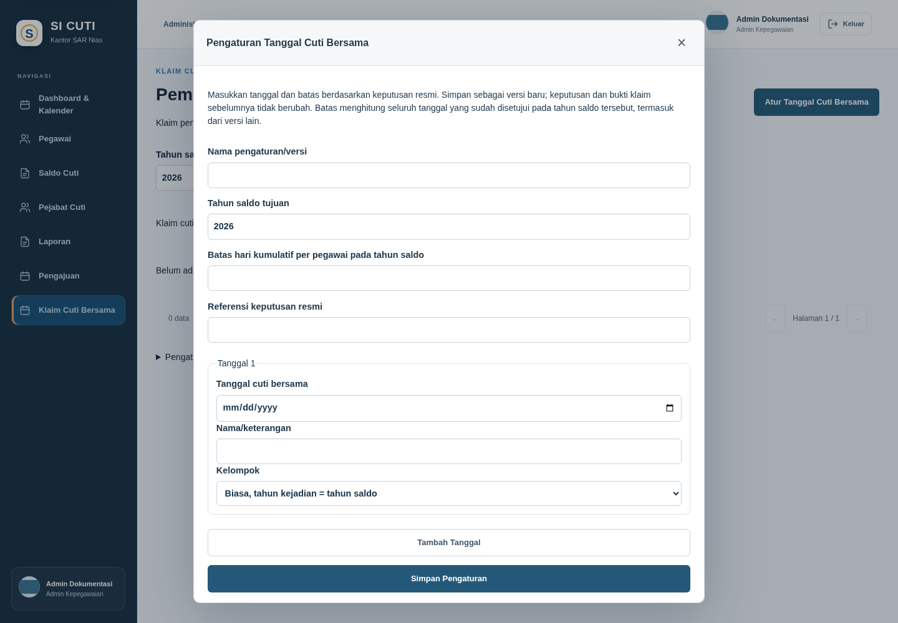

_Gambar 32. Form konfigurasi tersedia; simpan HTTP500 belum berhasil._

**Tujuan/menu/prasyarat.** Buka **Klaim Cuti Bersama**. Pengaturan klaim mempunyai dasar, tanggal dan kuota yang terpisah dari overlay dan template saldo. Siapkan dasar resmi serta bukti penugasan/pelaksanaan yang benar.

**Urutan berdasarkan komponen/service, belum dibuktikan end-to-end di buku ini:**

1. **Atur Tanggal Cuti Bersama**: isi tahun saldo, dasar, kuota dan kelompok tanggal sesuai sumber yang sah, bukan contoh fixture.
2. Buka **Lihat Detail** klaim yang diajukan; periksa bukti dan setiap tanggal.
3. Pilih tanggal yang disetujui. Yang tidak dipilih ditolak dengan alasan; kosongkan semua untuk menolak seluruhnya.
4. Isi catatan, konfirmasi pemeriksaan bukti jika menyetujui, pilih **Pratinjau Keputusan**.
5. Periksa tambahan saldo/tahun/batas, lalu konfirmasi dan **Simpan Keputusan** hanya jika pemeriksaan benar.

**Hasil yang dirancang layanan.** Saldo klaim berasal dari tanggal yang disetujui dan dapat sebagian; klaim bukan bukti pegawai sedang cuti. Duplikasi tanggal aktif/disetujui ditolak sesuai aturan existing. **Pada error saat buku dibuat**, laporkan reproduksi dan hentikan retry yang membuat pengajuan baru. Status, penolakan sebagian dan notifikasi duplikasi tidak diganti screenshot mock dalam buku ini.

## 7. Pemeriksaan cuti/izin, arsip dan pengembalian

### 7.1 Meninjau dan mengembalikan untuk perbaikan

**Tujuan/menu.** **Pengajuan → Cuti/Izin → pilih record**. Siapkan dasar pemeriksaan dan scan/bukti yang relevan; periksa pemohon, revisi, periode, alasan dan riwayat.

1. Pilih tab yang tepat; Cuti dan Izin tidak dicampur sebagai satu saldo.
2. Buka record berstatus Diajukan, baca detail dan versi dokumen.
3. Bila perlu perbaikan, pilih **Kembalikan**, isi catatan yang dapat ditindaklanjuti dan konfirmasi.
4. Tunggu pengajuan ulang dari Pegawai dan periksa revisi terbarunya.

**Hasil.** Perlu diperbaiki bukan keputusan final; Pegawai memperbaiki record yang sama. **Jika status sudah berubah**, muat ulang dan jangan memproses detail lama. Jika dokumen belum sesuai, jangan memakai persetujuan untuk melewati pemeriksaan.

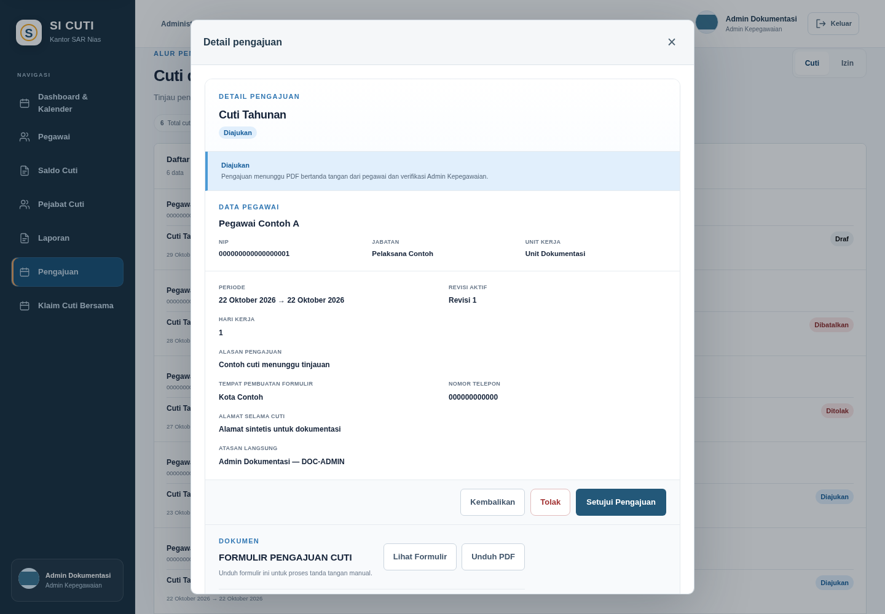

_Gambar 33. Detail request dengan scan dan aksi pemeriksaan._

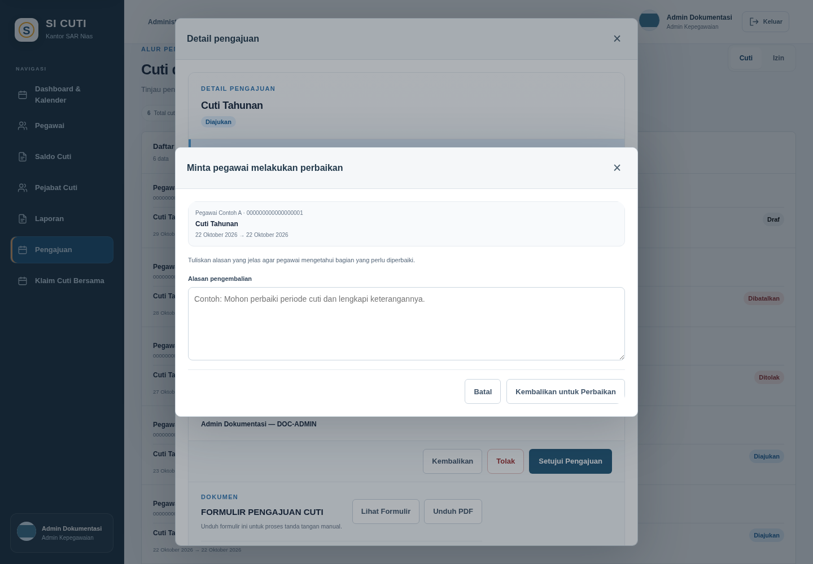

_Gambar 34. Dialog catatan pengembalian, bukan penolakan._

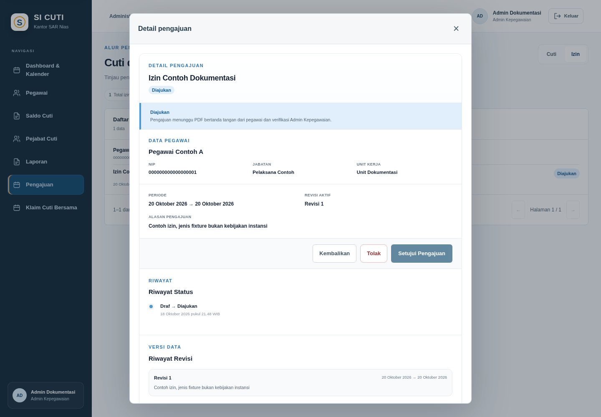

_Gambar 35. Review izin terpisah, tidak mengurangi saldo._

### 7.2 Mencatat penolakan atau persetujuan

**Tujuan/menu.** Gunakan tindakan keputusan pada detail Diajukan. Siapkan keputusan/dasar yang sah. Tindakan aplikasi mencatat administrasi, tidak membuat kewenangan tanda tangan baru.

1. Untuk menolak, pilih **Tolak Pengajuan**, isi alasan yang jelas dan dasar/referensi yang diminta. Record Ditolak final; pengajuan baru berikutnya memakai record baru.
2. Untuk menyetujui Cuti, pastikan scan bertanda tangan revisi terkait tersedia. Bila ada beberapa versi, pilih **scan sumber yang tepat**, bukan otomatis menganggap versi terakhir benar.
3. Isi referensi bukti/dasar sesuai dialog, periksa konfirmasi lalu simpan keputusan.
4. Periksa status, riwayat dan arsip. Pada Izin, isi referensi bukti yang diminta; Izin tidak menjalankan pemotongan saldo Cuti Tahunan.

**Hasil.** Persetujuan Cuti Tahunan mengubah cadangan menjadi komitmen sesuai layanan saldo; penolakan/pengembalian melepaskan cadangan sesuai workflow. **Jika tombol persetujuan nonaktif**, periksa scan dan status/revisi. Jika hasil tak diketahui, muat ulang status dan riwayat sebelum mengulang, bukan mengambil keputusan berlawanan secara tergesa-gesa.

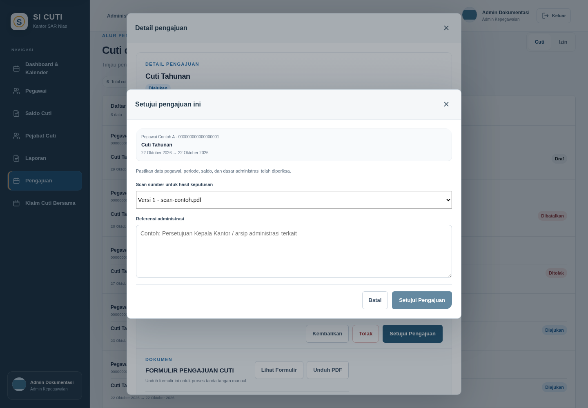

_Gambar 36. Memilih scan sumber dan dasar keputusan._

### 7.3 Arsip final dan edisi penanda

**Tujuan/menu.** Bagian **Arsip Hasil Keputusan** tersedia pada record Cuti final. Siapkan scan sumber yang sudah dipin serta kewenangan untuk penanda bila diperlukan.

1. Baca status, sumber/versi, snapshot dan ketersediaan PDF.
2. Unduh PDF keputusan melalui tombol pada arsip, lalu periksa file pada perangkat.
3. Jika memakai penanda pada edisi turunan, atur posisi, **preview**, verifikasi dan simpan edisi sesuai dialog; jangan menimpa scan asli.
4. Untuk arsip legacy yang belum mempunyai sumber terverifikasi, ikuti tindakan verifikasi eksplisit yang tersedia; jangan mengarang nama/tanggal historis dari master saat ini.

**Hasil.** Scan asli, formulir awal, arsip final dan edisi penanda adalah berkas/peran berbeda. **Jika arsip belum siap atau sumber bermasalah**, periksa melalui proses yang berwenang; jangan mengunggah pengganti di folder storage dari luar aplikasi. Penanda bukan tanda tangan elektronik tersertifikasi, cap resmi baru atau nomor surat yang dibuat panduan.

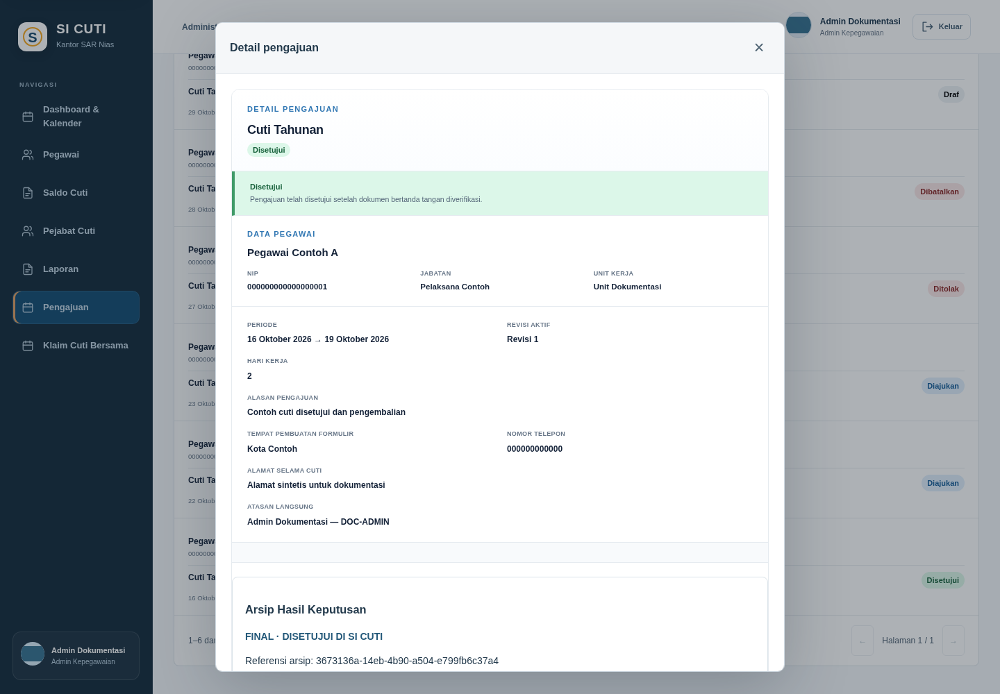

_Gambar 37. Arsip final, sumber dan edisi penanda._

### 7.4 Pengembalian Cuti Tahunan yang disetujui

**Tujuan/menu.** Pada detail yang sesuai pilih **Catat Pengembalian Cuti**. Siapkan jumlah hari kerja penuh yang sah tidak digunakan, alasan, referensi/tanggal dasar, bukti PDF maksimal 10 MB dan pemeriksaan faktual non-penggunaan.

1. Unggah bukti melalui form, isi jumlah dan dasar.
2. Nyatakan pemeriksaan hanya jika benar-benar dilakukan.
3. Buat preview, periksa alokasi asal, jumlah yang sudah dikembalikan dan sisa maksimum teknis.
4. Konfirmasi dan simpan, kemudian periksa histori dan saldo.

**Hasil.** Kompensasi tercatat terpisah, record tetap **Disetujui**. Batas teknis bukan bukti hari benar-benar tidak digunakan. **Jika preview ditolak**, periksa tahun/alokasi/bukti/rollover; tidak otomatis mengalihkan saldo tahun lama ke tahun berjalan. Jangan menebak tanggal penggunaan aktual dari jumlah pengembalian atau mengubah periode pada kalender.

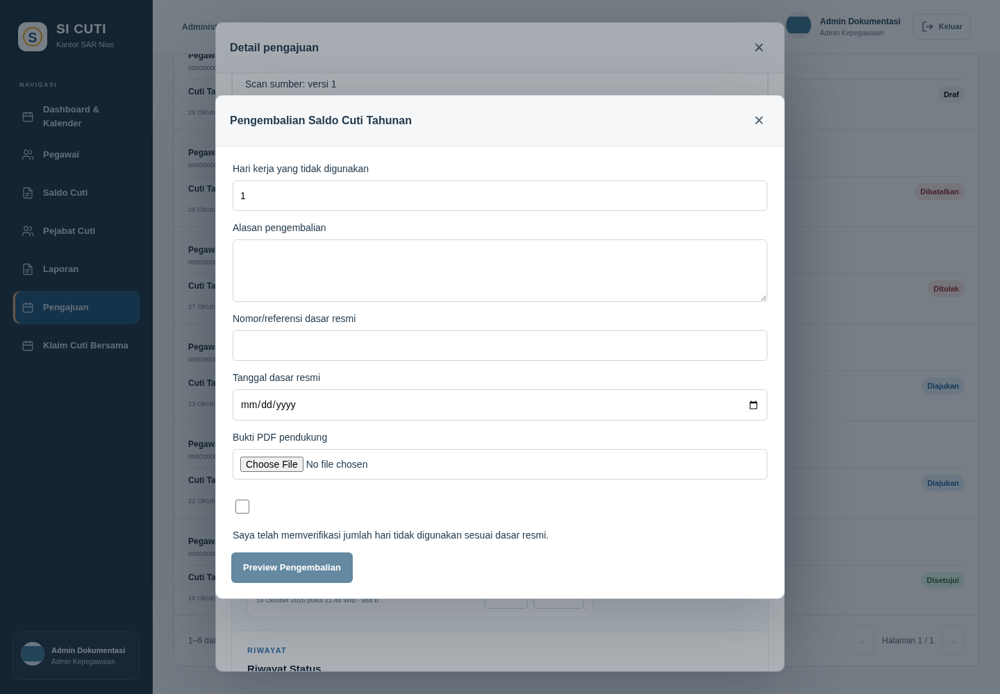

_Gambar 38. Bukti, dasar, jumlah dan attestation pengembalian._

## 8. Laporan Cuti dan Izin

### 8.1 Filter dan preview

**Tujuan/menu.** Buka **Laporan**, pilih **Cuti** (R1) atau **Izin** (R2). Siapkan periode dan lingkup laporan; keduanya merupakan laporan operasional, bukan laporan historis posisi akhir tahun.

1. Isi tanggal dari/sampai, status, jenis, nama/NIP atau pegawai, unit persis dan keaktifan bila diperlukan. Pada ponsel buka **Filter laporan**.
2. Default status **Disetujui**; pilihan non-draf lain tersedia. Rentang maksimal 366 hari.
3. Klik **Buat pratinjau**, tunggu hasil; setelah mengubah filter buat **pratinjau baru** agar hasil/unduhan sesuai filter terbaru.
4. Baca ringkasan, catatan makna angka dan halaman pratinjau.

**Hasil.** Data dibekukan saat preview, memakai revisi yang dirujuk saat itu. Maksimal 1.000 baris; lebih dari batas ditolak, bukan dipotong diam-diam. **Jika kosong/terlalu banyak**, periksa atau persempit filter, jangan mengekspor hasil yang berbeda dari lingkup yang dimaksud.

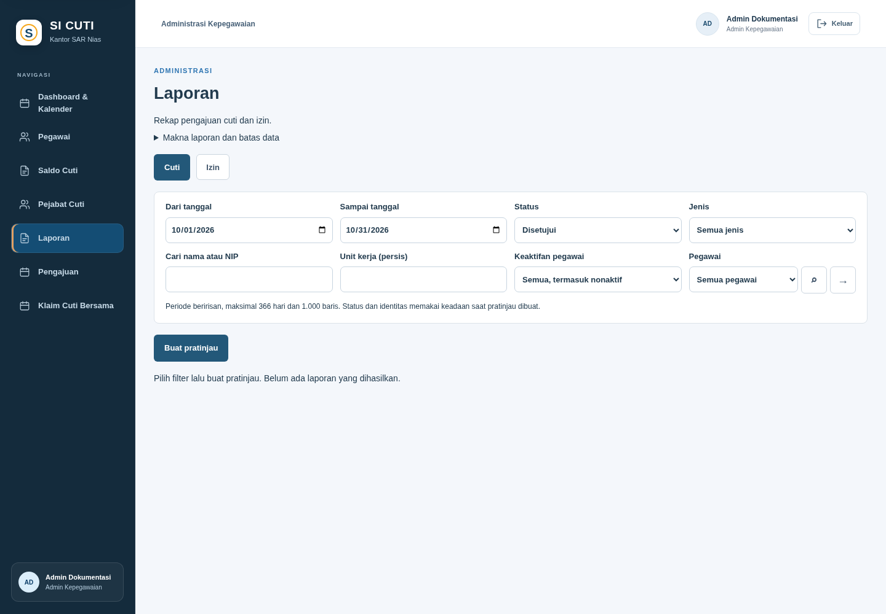

_Gambar 39. Filter ringkas laporan cuti dan izin terpisah._

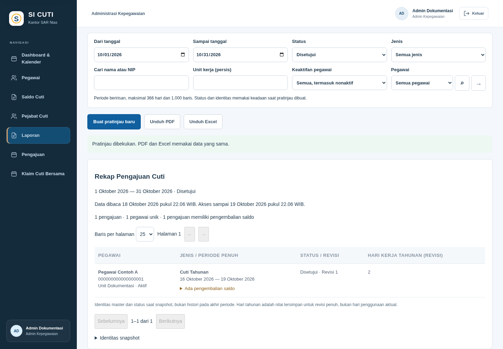

_Gambar 40. Snapshot pratinjau Cuti, masa berlaku dan unit angka._

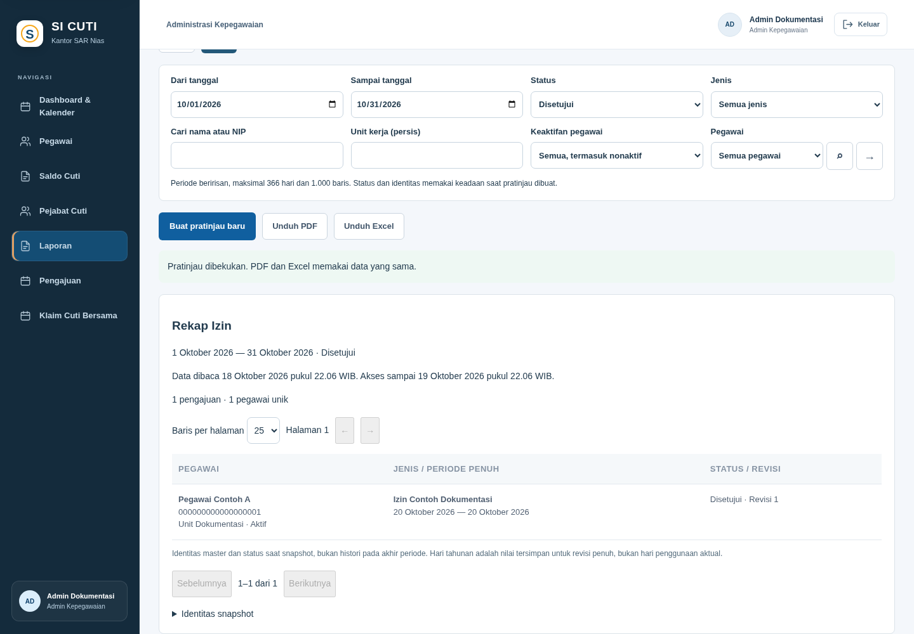

_Gambar 41. Snapshot pratinjau Izin, masa berlaku dan unit angka._

Filter periode memakai overlap periode pengajuan, termasuk lintas bulan/tahun. Identitas/status adalah yang dibaca ketika snapshot dibuat, **bukan** status historis pada akhir periode. Hari persetujuan penuh bukan hari penggunaan aktual; pengembalian tidak dihitung sebagai pengajuan baru atau mengubah APPROVED. Tidak ada perhitungan TUKIN, disiplin atau kesiapan personel.

### 8.2 PDF, Excel, retry dan kedaluwarsa

**Tujuan/menu.** Setelah preview gunakan **Unduh PDF** atau **Unduh Excel** pada snapshot yang sama. Siapkan browser yang mengizinkan unduhan.

1. Pastikan filter belum berubah dan preview yang dibaca benar.
2. Pilih format, tunggu proses ekspor/pengambilan berkas.
3. Baca pesan operasi; periksa daftar unduhan perangkat dan buka hasilnya.
4. Jika gagal, gunakan retry yang ditawarkan untuk permintaan yang sama. Jika sesi berakhir, login ulang; jangan memakai URL anonim atau akun Admin lain.
5. Jika **kedaluwarsa** (masa akses snapshot 24 jam), buat preview baru. Hasil baru dapat berbeda karena data saat ini sudah berubah.

**Hasil.** PDF dan Excel dari satu preview memakai dataset yang sama; NIP disimpan sebagai teks di Excel. **Jika NetworkError/HTML/non-JSON/transfer putus terjadi**, jangan menganggap file sudah pasti tersimpan ataupun pasti gagal tersimpan. Periksa unduhan dan ulangi melalui alur sah; error create/preview/export/fetch/handoff adalah operasi berbeda.

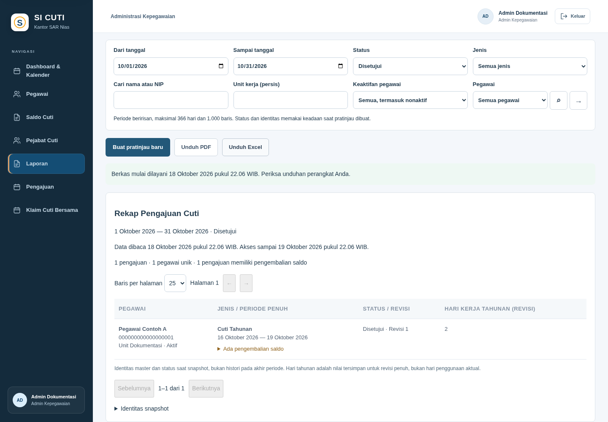

_Gambar 42. Handoff PDF/Excel berhasil dimulai; penyimpanan perangkat tidak diasumsikan._

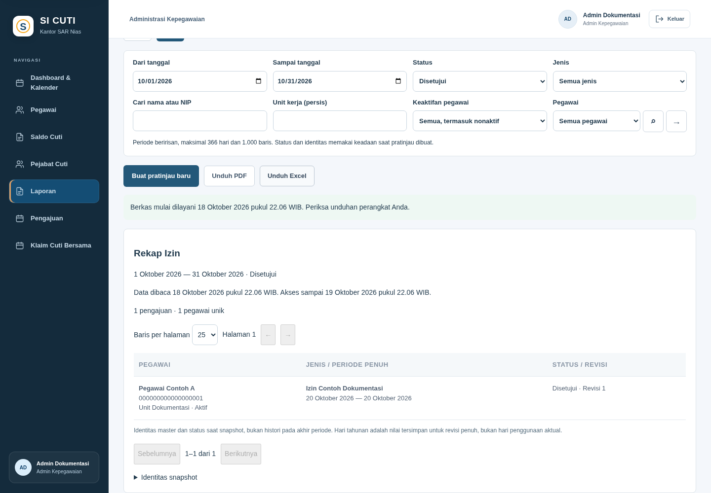

_Gambar 43. Handoff PDF/Excel berhasil dimulai; penyimpanan perangkat tidak diasumsikan._

Tidak ada tombol laporan posisi saldo historis, rekap klaim atau pengembalian sebagai katalog M7 tambahan pada versi ini. Kedaluwarsa akses aktif bukan jaminan penghapusan semua backup; retensi audit laporan mempunyai kebijakan terpisah. Pesan kedaluwarsa 24 jam dijelaskan dari kode, belum difoto dengan menunggu 24 jam atau memalsukan clock aplikasi.

## 9. Profil sendiri, bantuan dan glosarium

### 9.1 Foto akun Admin sendiri

**Tujuan/menu.** Buka avatar atau **Profil Saya**. Siapkan JPEG/PNG maksimal 5 MiB; gambar animasi, SVG, URL eksternal, dimensi berlebihan dan file rusak ditolak.

1. **Pilih foto/Ganti foto**, periksa preview lokal.
2. Klik **Simpan foto**; memilih file saja belum menyimpan.
3. Untuk hapus, pilih **Hapus foto → Ya, hapus foto**; Escape membatalkan konfirmasi.
4. Periksa header/sidebar/profil; saat tidak ada foto/gambar gagal, inisial dipakai. Gunakan muat ulang/retry sesuai pesan.

**Hasil.** Foto sendiri dinormalisasi maksimal 512×512 dengan rasio terjaga, tidak masuk formulir/PDF/laporan/snapshot. **Jika ganti gagal**, foto lama dipertahankan; konflik versi perlu muat ulang. Penghapusan aktif tidak menghapus semua backup/salinan perangkat seketika. Tidak ada akses Admin untuk mengelola foto pegawai lain.

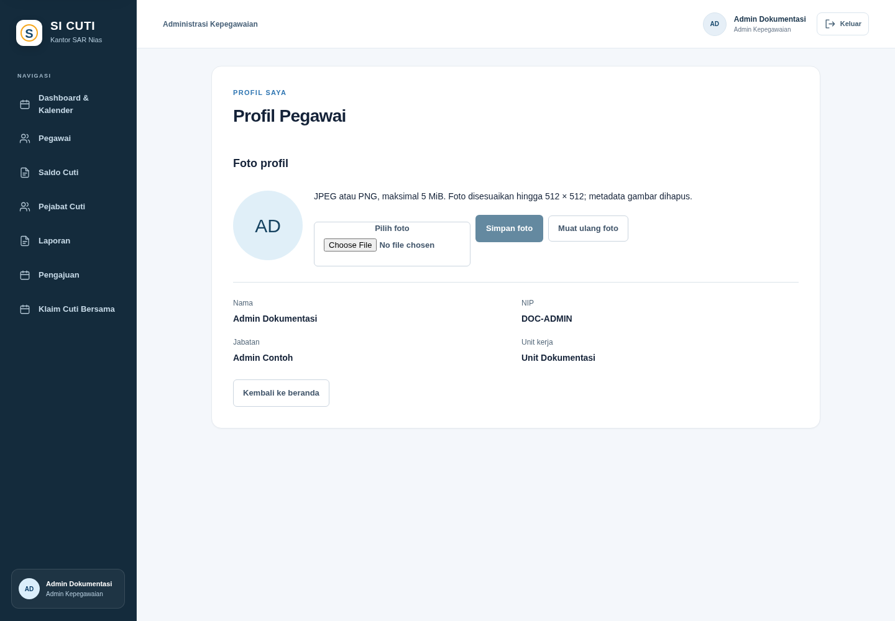

_Gambar 44. Profil sendiri dengan fallback inisial._

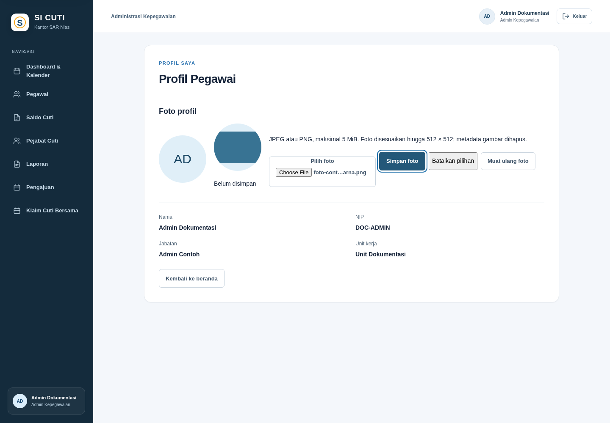

_Gambar 45. Preview foto sintetis lokal belum disimpan._

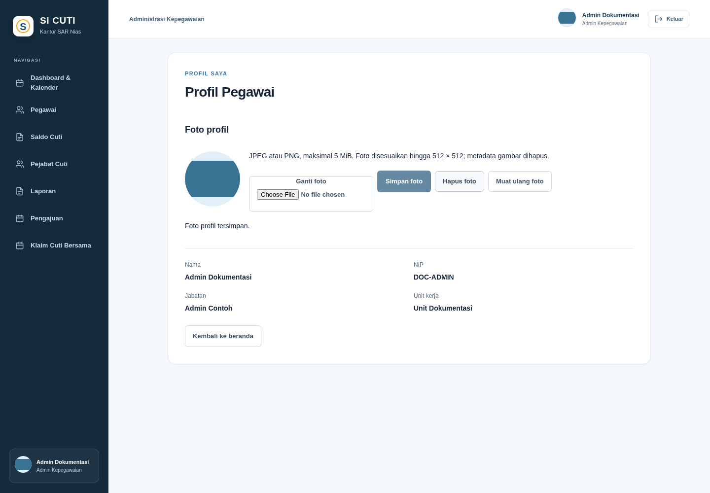

_Gambar 46. Foto diri sendiri tersimpan, header/sidebar diperbarui._

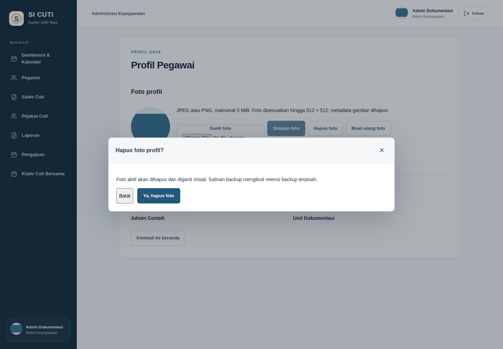

_Gambar 47. Konfirmasi hapus foto sendiri._

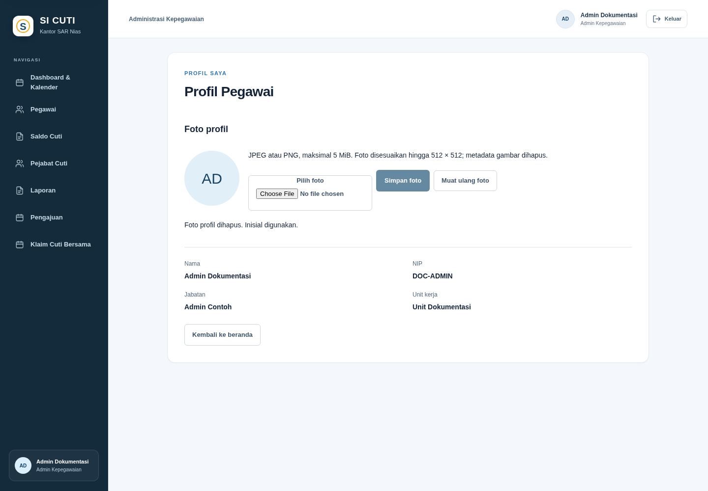

_Gambar 48. Foto dihapus; inisial dipakai kembali._

### 9.2 Penanganan masalah

| Kondisi                                       | Penanganan                                                                                                           |
| --------------------------------------------- | -------------------------------------------------------------------------------------------------------------------- |
| Data gagal dimuat/status akun tidak terbaca   | Coba lagi atau masuk ulang; jangan menyimpulkan record/akun belum ada.                                               |
| Konflik edit/versi berubah                    | Tutup form, muat ulang dan tinjau perubahan terbaru.                                                                 |
| Employee aktif tetapi tidak dapat login       | Periksa status akun/identity dan kredensial; lifecycle terpisah.                                                     |
| Admin terakhir ditolak untuk dinonaktifkan    | Pertahankan akses administratif sesuai invariant, jangan memaksa lewat DB.                                           |
| NIP impor ditolak sebagai numeric/duplikat    | Perbaiki file sumber bertipe teks dan periksa record existing/Arsip.                                                 |
| Hasil konfirmasi impor belum diketahui        | Pertahankan file/konteks retry; periksa daftar, jangan membuat batch baru untuk melewati ketidakpastian.             |
| Saldo PARTIAL                                 | Pemeriksaan berwenang; bukan nol, bukan overwrite otomatis.                                                          |
| Klaim HTTP 500                                | Catat menu/waktu/pesan tanpa secret; lihat bug lokal checkpoint, jangan memasukkan klaim ulang sebagai jalan pintas. |
| PDF/Excel tidak terlihat setelah tombol unduh | Periksa unduhan/izin perangkat; pesan handoff bukan bukti file tersimpan.                                            |

**Glosarium.** Employee/master Pegawai: identitas bisnis. User/Akun: akses login. Arsip Pegawai: pegawai nonaktif, bukan penghapusan. Preview: pembacaan/validasi sebelum keputusan simpan. READY/SKIP/ERROR: siap/dilewati/tidak valid pada batch saldo. Snapshot: salinan data pada saat peristiwa. Scan sumber: file asli yang dipin keputusan. Edisi: turunan penanda, bukan overwrite. Kompensasi: pengembalian terpisah dengan jejak ledger. Overlay: informasi tanggal tampilan. Rollout: penerapan versi oleh operator; merge/CI/health tidak sama dengan rollout atau UAT.
