# Panduan Pegawai

**SI CUTI — Kantor Pencarian dan Pertolongan Kelas B Nias**

Versi panduan **1.0** · **18 Oktober 2026 WIB**

Sumber aplikasi: `4c341b0b67bbeed0ea366fb22b3d369c47677b39`

Contoh lokal, data sintetis. Panduan penggunaan, **bukan kebijakan cuti baru atau bukti kesiapan produksi**.

Nama “Pegawai Contoh”, NIP berawalan nol, alamat, kontak, alasan, scan, dan penugasan pada gambar adalah data latihan. Bidang warna pada profil menggantikan foto; tidak memakai foto pegawai nyata. Gambar merupakan aplikasi yang benar-benar berjalan. Batas pembuktian ada pada [checkpoint](checkpoint-2026-10-18.md) dan [inventaris](inventaris-halaman.md).

## Daftar isi

1. [Masuk dan navigasi](#1-masuk-dan-navigasi)
2. [Beranda, saldo, kalender dan agenda](#2-beranda-saldo-kalender-dan-agenda)
3. [Membuat draf dan mengajukan cuti](#3-membuat-draf-dan-mengajukan-cuti)
4. [Perbaikan, penolakan dan pembatalan](#4-perbaikan-penolakan-dan-pembatalan)
5. [Formulir, scan, keputusan dan pengembalian saldo](#5-formulir-scan-keputusan-dan-pengembalian-saldo)
6. [Izin](#6-izin)
7. [Klaim Cuti Bersama](#7-klaim-cuti-bersama)
8. [Profil dan foto sendiri](#8-profil-dan-foto-sendiri)
9. [Masalah umum dan glosarium](#9-masalah-umum-dan-glosarium)

## 1. Masuk dan navigasi

### 1.1 Masuk ke akun

**Kegunaan dan menu.** Buka alamat SI CUTI yang diberikan instansi. Halaman masuk adalah pintu ke layanan milik Anda. Siapkan NIP dan kata sandi dari pengelola akun, bukan akun contoh pada gambar.

1. Isi **NIP** sebagai teks; jangan menghilangkan awalan nol.
2. Isi **Kata sandi**. Tombol mata hanya membantu memeriksa isian di tempat yang aman.
3. Tekan **Masuk**, tunggu beranda muncul.

**Hasil.** Akun Pegawai masuk ke beranda sendiri. Anda tidak memperoleh daftar pegawai, pengaturan saldo, atau laporan Admin. **Jika gagal**, periksa NIP/kata sandi dan hubungi Admin untuk memeriksa status pegawai maupun akun. Pesan penolakan tidak membedakan akun tidak ditemukan dan kata sandi salah.

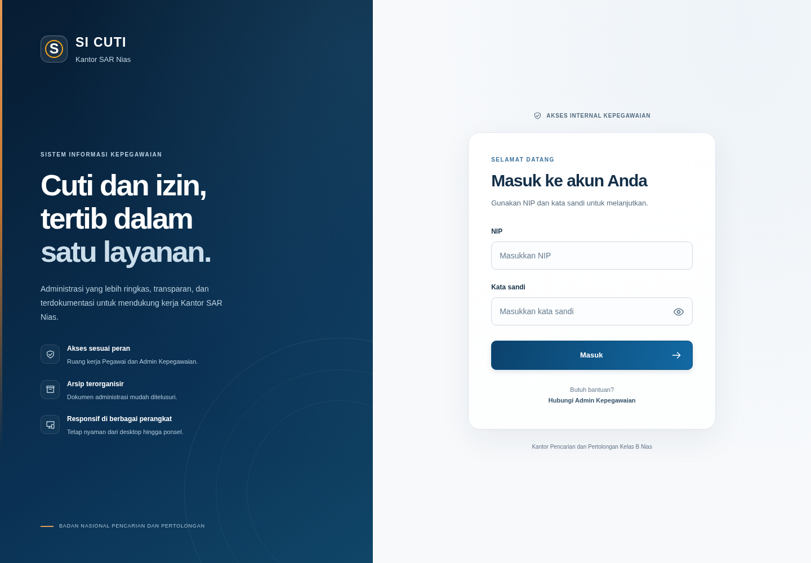

_Gambar 1. Form login kosong._

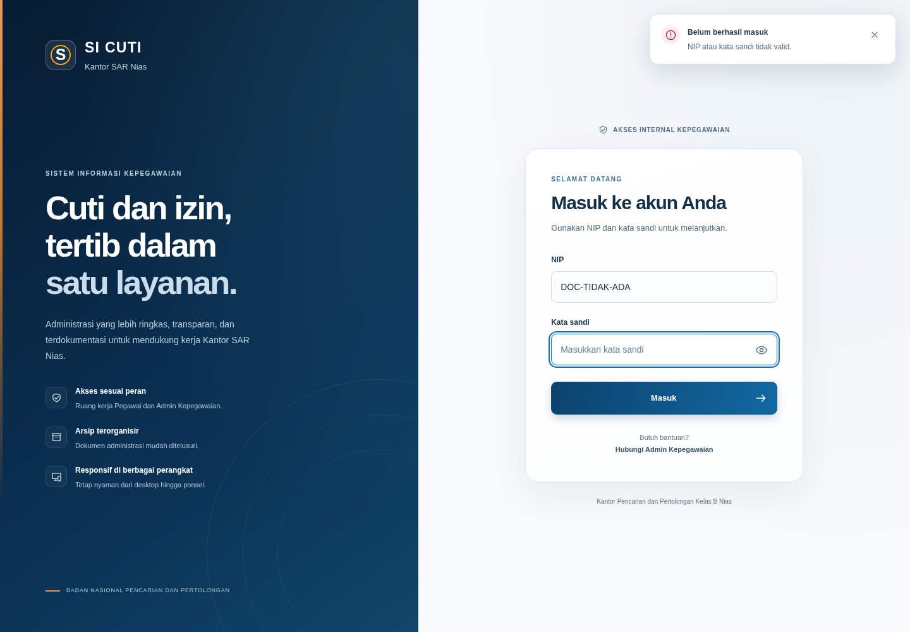

_Gambar 2. Penolakan login; password dikosongkan sebelum screenshot._

### 1.2 Menggunakan menu dan keluar

**Kegunaan/menu.** Sidebar menyediakan **Beranda & Kalender**, **Profil Saya**, **Pengajuan**, dan **Klaim Cuti Bersama**. Avatar akun juga membuka profil sendiri. Siapkan perangkat dengan koneksi dan sesi aktif.

1. Pilih menu, lalu tunggu data selesai dimuat.
2. Pada ponsel gunakan tombol buka menu; tutup dengan tombol tutup atau Escape pada keyboard.
3. Pada dialog gunakan Tab/Shift+Tab untuk berpindah, Escape atau tombol tutup untuk kembali. Jangan menutup perangkat saat operasi simpan masih berlangsung.
4. Selesai bekerja, tekan **Keluar**, terutama pada perangkat bersama.

**Hasil.** Keluar mengakhiri sesi dan kembali ke halaman masuk. **Jika halaman meminta masuk lagi**, login ulang; jangan mengandalkan tab lama sebagai bukti masih mempunyai akses. Tautan profil lama `/#profil` tetap tersedia; alamat `/profil` adalah halaman profil sendiri yang juga dipakai avatar.

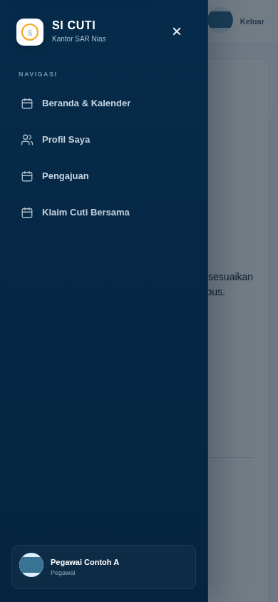

_Gambar 3. Menu ponsel dan navigasi keyboard._

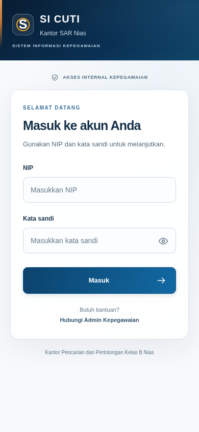

_Gambar 4. Logout kembali ke login, sesi berakhir._

Tidak ada fitur ubah kata sandi sendiri pada Profil Saya di sumber ini. Pemulihan/reset ditangani Admin melalui mekanisme akun yang tersedia. Jangan menyimpan kata sandi di file impor, screenshot, atau pesan bantuan.

## 2. Beranda, saldo, kalender dan agenda

### 2.1 Membaca saldo dan hal yang perlu ditindaklanjuti

**Kegunaan/menu.** Buka **Beranda & Kalender** untuk melihat saldo sendiri, ringkasan pengajuan dan aksi utama. Tidak perlu mengisi data; pastikan identitas akun benar.

1. Baca saldo tahun berjalan dan bucket **Cuti N**, **Cuti N-1**, **Cuti N-2**, serta **Klaim Cuti Bersama**.
2. Periksa ringkasan draf/perlu perbaikan dan status pengajuan.
3. Pilih **Ajukan Cuti**, **Ajukan Izin**, atau menu klaim sesuai kebutuhan.

**Hasil.** Angka tersedia adalah hasil pembacaan layanan saldo, bukan tombol menambah saldo. Saldo yang sedang dicadangkan pengajuan berbeda dari yang sudah digunakan dalam pencatatan persetujuan. **Jika “belum disiapkan”/“perlu diperiksa” muncul**, hubungi Admin; nilai tersebut bukan saldo nol dan tidak boleh diperbaiki dengan membuat permohonan berulang.

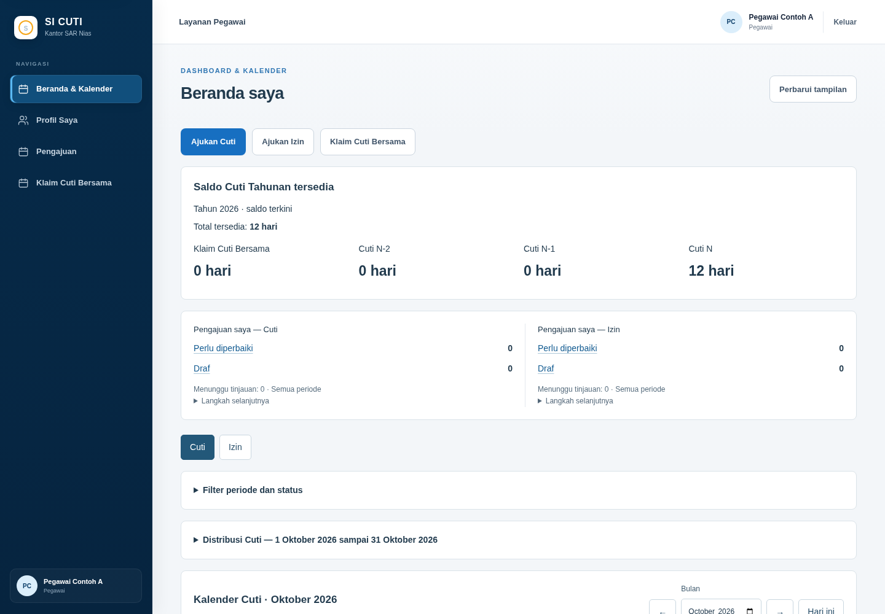

_Gambar 5. Saldo sendiri, ringkasan tindakan dan aksi utama._

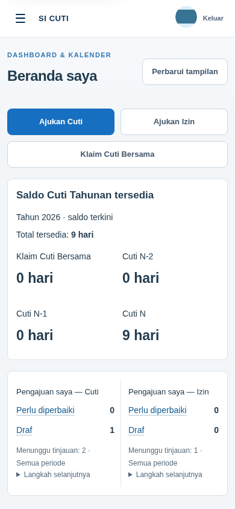

_Gambar 6. Viewport 390×844; data sendiri._

### 2.2 Memilih bulan, kategori dan tanggal

**Kegunaan/menu.** Kalender dan agenda berada di beranda yang sama. Siapkan bulan/periode yang ingin dilihat. Anda hanya melihat pengajuan sendiri, bukan identitas atau jadwal pegawai lain.

1. Pilih tab **Cuti** atau **Izin**, bulan, dan filter yang tersedia. Bantuan/filter tambahan dapat dibuka jika diperlukan.
2. Baca chip “Cuti saya”/“Izin saya”, jenis dan statusnya; pengajuan beberapa hari dapat muncul pada beberapa tanggal.
3. Klik sebuah tanggal untuk memusatkan agenda pada hari tersebut. Gunakan halaman berikutnya jika agenda lebih dari satu halaman.
4. Lihat legenda: Sabtu/Minggu merah; **LN** untuk Libur Nasional dan **CB** untuk Cuti Bersama jika dataset tersedia. Penanda hari ini dan tanggal dipilih tetap berbeda.

**Hasil.** Kalender menunjukkan **periode persetujuan/pengajuan**, bukan bukti tanggal penggunaan aktual. Satu pengajuan yang muncul berulang di tanggal berbeda tetap satu pengajuan. Penanda pengembalian tidak memendekkan periodenya. **Jika kalender kosong**, periksa filter; itu bukan jaminan saldo cukup, eligibility, atau kesiapan personel. “Data tahun ini belum tersedia” berarti overlay belum diterbitkan, bukan tidak ada hari libur.

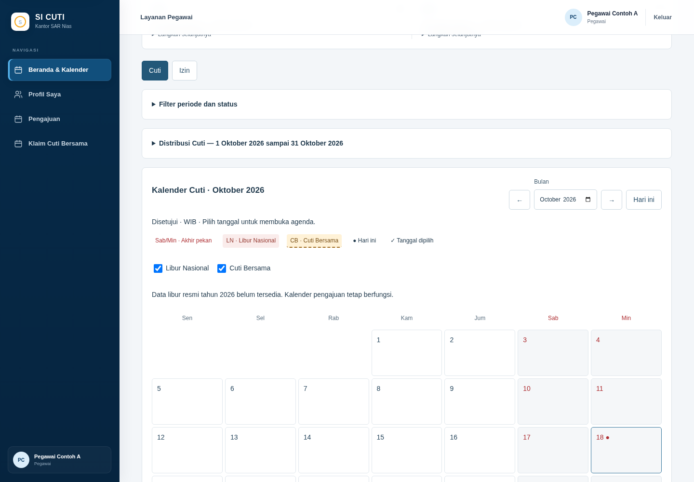

_Gambar 7. Kalender personal, legenda, hari ini dan agenda._

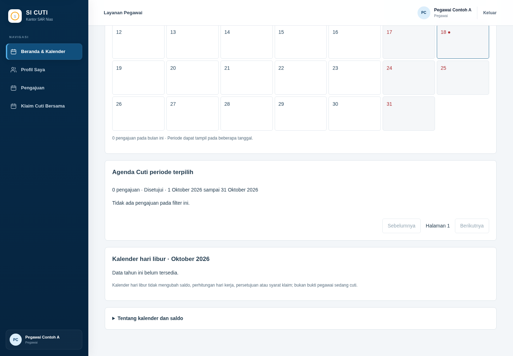

_Gambar 8. Agenda sendiri dan penanda pengembalian._

Overlay hanya lapisan informasi. Tidak otomatis mengubah penghitung hari kerja, saldo, persetujuan, atau hak klaim. Ringkasan tetap di beranda mempunyai lingkup sendiri; mengubah filter periode kalender tidak mengubah arti kartu ringkasan tetap.

## 3. Membuat draf dan mengajukan cuti

### 3.1 Mengisi dan menyimpan draf

**Kegunaan/menu.** Pilih **Ajukan Cuti** di beranda atau **Pengajuan → Cuti → + Pengajuan Baru**. Siapkan jenis cuti, tanggal mulai/selesai, alasan, tempat pembuatan formulir, alamat selama cuti dan nomor telepon. Semua data contoh pada gambar harus diganti data yang benar saat bekerja di lingkungan resmi.

1. Pilih jenis cuti yang sesuai kebutuhan, bukan mengganti jenis untuk melewati pemeriksaan.
2. Isi tanggal berurutan dan alasan yang jelas.
3. Isi tempat, alamat dan telepon yang diminta formulir.
4. Tekan **Simpan Draf**. Penyimpanan ini belum mengirim kepada Admin.
5. Buka draf dari daftar dan gunakan **Edit Draf** jika perlu.

**Hasil.** Status **Draf** dan detail tersimpan terlihat. Draf dapat diperbaiki sebelum diajukan. **Jika gagal**, baca kolom yang diminta, periksa tanggal/koneksi dan periksa daftar sebelum mengulangi penyimpanan setelah respons terputus.

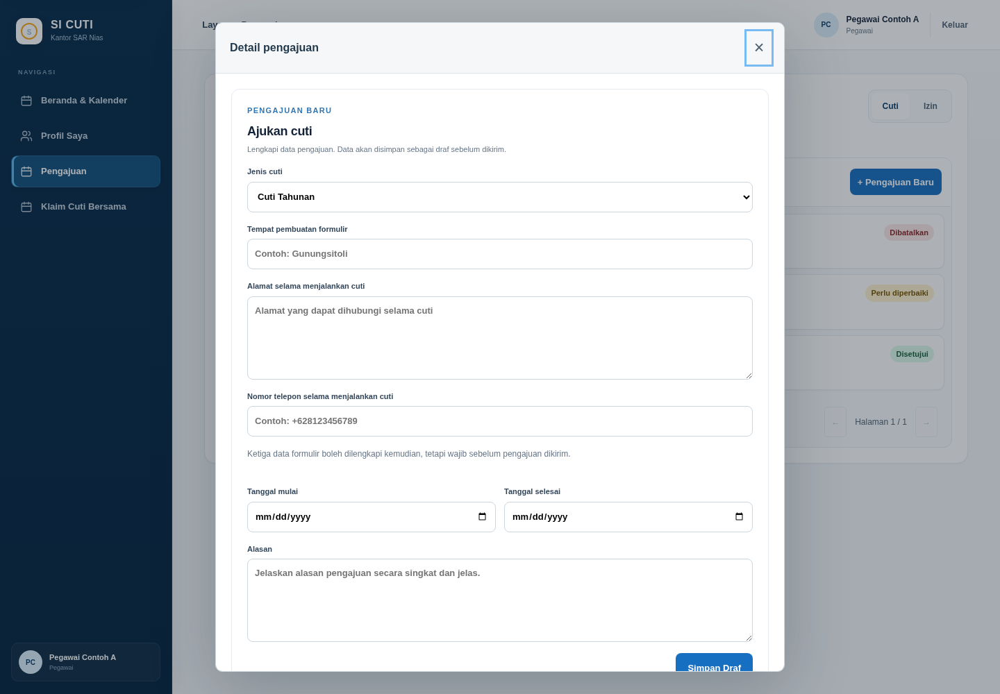

_Gambar 9. Form pengajuan baru sebelum disimpan._

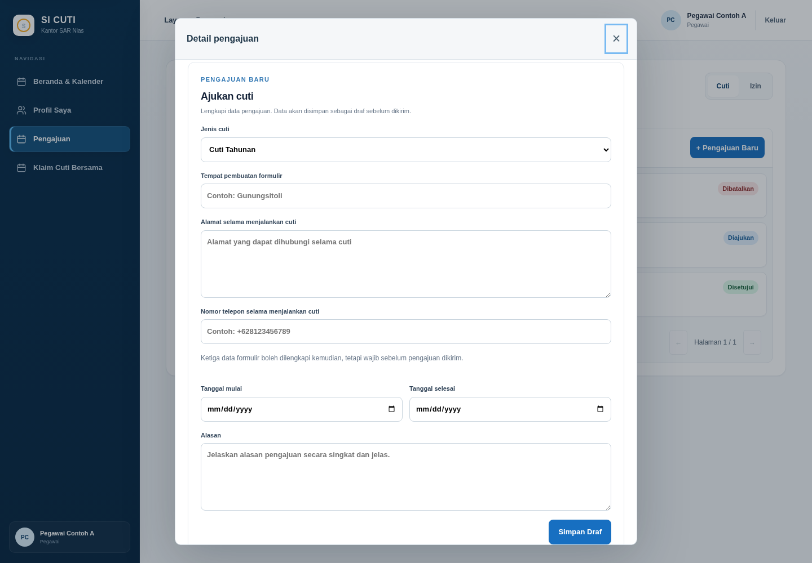

_Gambar 10. Tanggal, alasan dan Simpan Draf pada bagian bawah form._

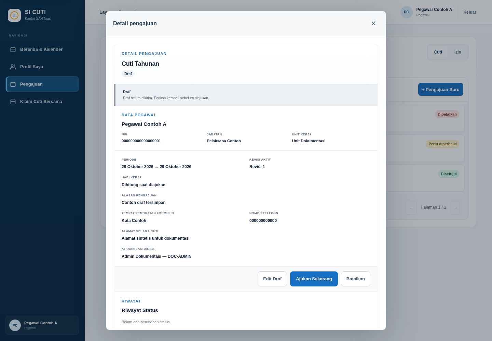

_Gambar 11. Detail draf._

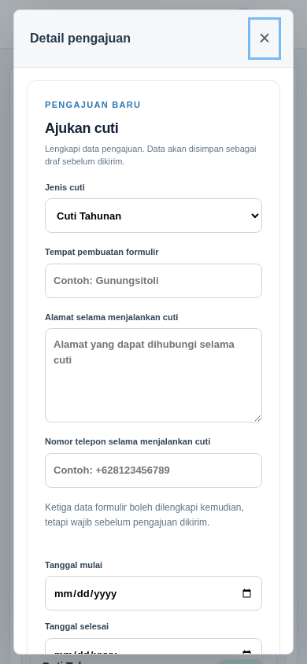

_Gambar 12. Viewport 390×844; data sendiri._

Pilihan jenis yang tampak bukan keputusan otomatis tentang hak/kelengkapan cuti. Sistem tidak menggantikan pemeriksaan kebijakan dan dokumen instansi. Contoh lengkap panduan ini memakai Cuti Tahunan; tidak membuktikan UAT seluruh jenis cuti selesai.

### 3.2 Mengirim draf

**Kegunaan/menu.** Di detail draf pilih **Ajukan Sekarang** setelah isian benar. Siapkan data lengkap dan saldo yang sudah siap jika mengajukan Cuti Tahunan.

1. Baca kembali identitas, jenis, tanggal, alasan, alamat dan kontak.
2. Tekan **Ajukan Sekarang** satu kali, tunggu hasil.
3. Periksa status **Diajukan**/menunggu tinjauan dan riwayat.
4. Lanjutkan proses formulir dan scan pada Bab 5.

**Hasil.** Revisi yang dikirim dibekukan; Cuti Tahunan mencadangkan saldo sesuai layanan existing. **Jika gagal**, jangan memindahkan tanggal ke tahun lain atau mengubah jenis untuk menghindari pesan. Saldo tidak cukup/belum siap, data masa kerja atau rentang lintas tahun yang belum didukung perlu ditangani sesuai pesan dan bantuan Admin.

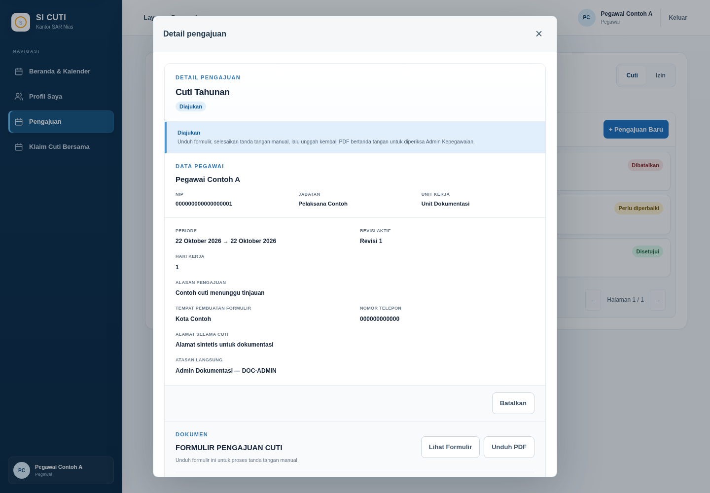

_Gambar 13. Detail diajukan._

Daftar pengajuan memakai pagination lokal 10 per halaman. Gunakan navigasi halaman untuk menemukan record lama; jangan membuat ulang hanya karena belum terlihat pada halaman pertama.

## 4. Perbaikan, penolakan dan pembatalan

### 4.1 Pengajuan dikembalikan untuk perbaikan

**Kegunaan/menu.** Buka detail berstatus **Perlu diperbaiki** pada Pengajuan. Siapkan data/dokumen sesuai catatan Admin.

1. Baca alasan di detail dan **Riwayat Status**.
2. Pilih **Perbaiki Pengajuan**, ubah bagian yang diminta, simpan perubahan.
3. Setelah tersimpan, pilih **Ajukan Kembali**. Mengedit saja belum mengirim ulang.
4. Periksa nomor revisi baru dan status; unggah scan untuk revisi baru jika diperlukan.

**Hasil.** Record yang sama berlanjut dengan revisi berikutnya; riwayat tidak ditimpa. **Jika gagal**, periksa status terbaru—Admin mungkin telah memprosesnya—dan muat ulang sebelum bertindak lagi. Jangan memakai scan revisi lama sebagai bukti revisi baru tanpa pemeriksaan.

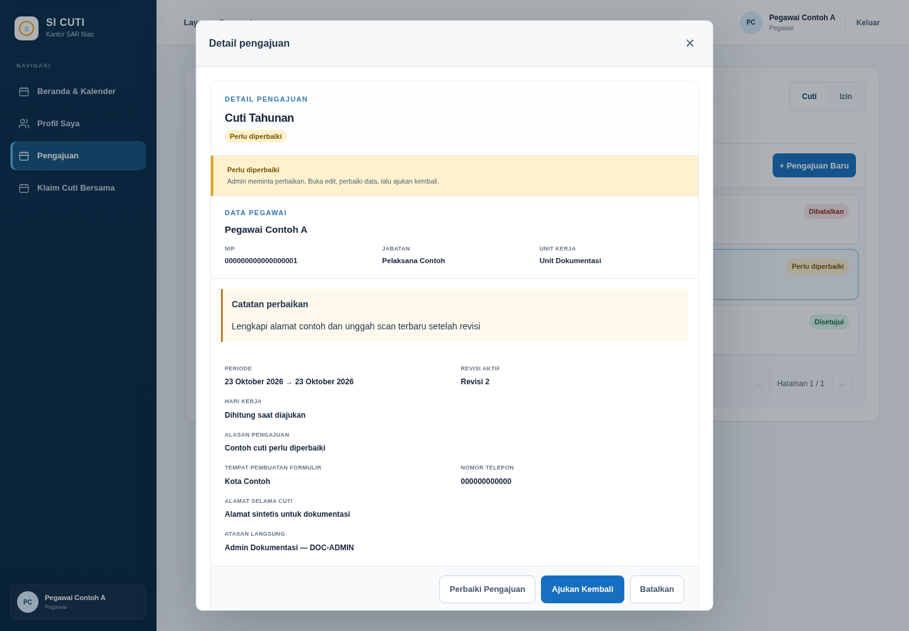

_Gambar 14. Detail perbaikan._

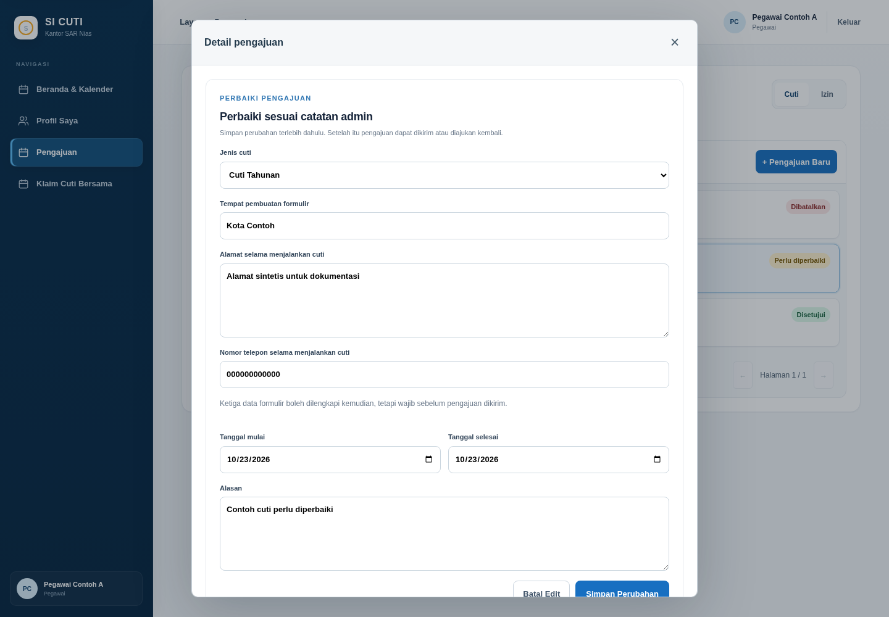

_Gambar 15. Edit revisi dikembalikan sebelum diajukan kembali._

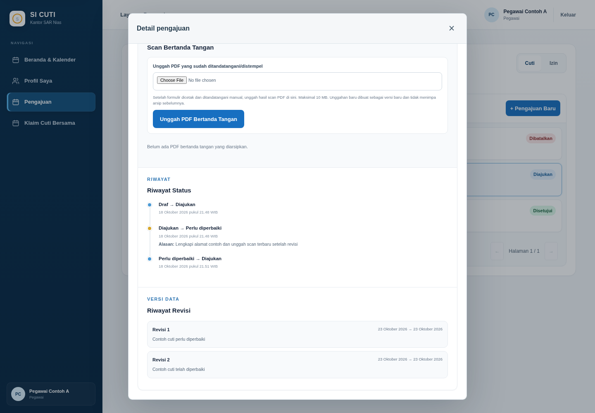

_Gambar 16. Revisi berikutnya dan status diajukan kembali._

### 4.2 Pengajuan ditolak

**Kegunaan/menu.** Detail **Ditolak** menjelaskan keputusan final pada record tersebut. Siapkan alasan penolakan sebagai dasar pembicaraan dengan Admin.

1. Baca alasan dan riwayat status.
2. Lihat/unduh arsip hasil penolakan bila tersedia.
3. Jika memang akan mengajukan lagi, gunakan **pengajuan baru**, bukan mengubah record final lama.

**Hasil.** Riwayat penolakan tetap tersimpan. **Jika tidak memahami dasar penolakan**, minta penjelasan Admin; jangan menyamakan penolakan dengan permintaan perbaikan. Tombol “Ajukan Kembali” bukan alur membuka ulang record Ditolak.

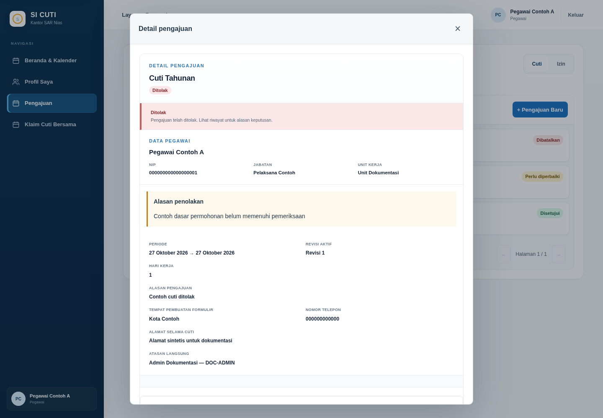

_Gambar 17. Detail ditolak._

### 4.3 Membatalkan sebelum keputusan final

**Kegunaan/menu.** Tombol **Batalkan** tersedia pada draf, diajukan atau perlu perbaikan milik sendiri. Siapkan kepastian bahwa permohonan tersebut tidak dilanjutkan.

1. Buka record yang benar dan periksa periodenya.
2. Pilih **Batalkan**, tunggu hasil lalu periksa status.

**Hasil.** Record menjadi **Dibatalkan** dan histori tetap ada; cadangan saldo yang terkait dilepas sesuai workflow. **Jika sudah Disetujui/Ditolak**, record final tidak dapat dibatalkan melalui tombol ini. Pengembalian saldo setelah persetujuan adalah proses berbeda oleh Admin dengan bukti.

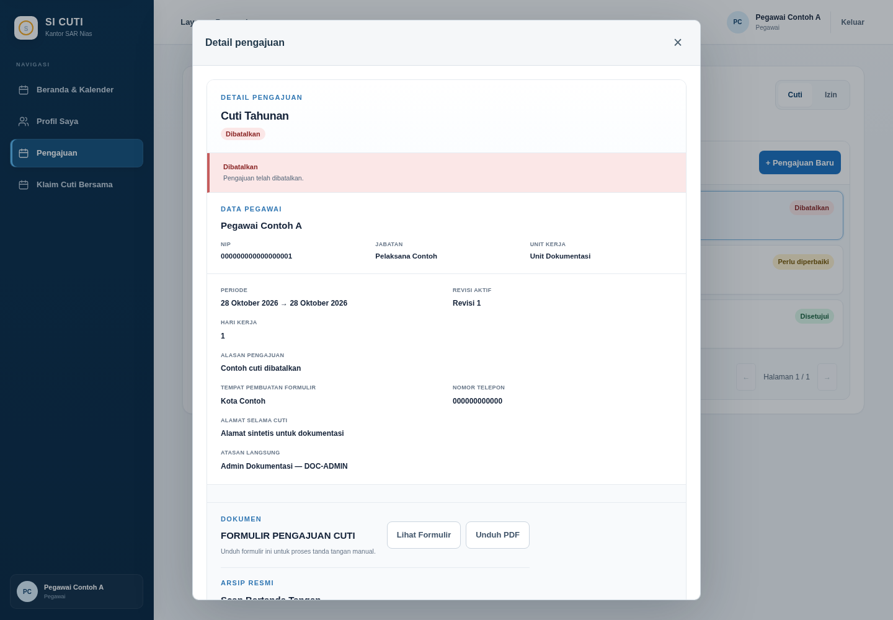

_Gambar 18. Detail dibatalkan._

## 5. Formulir, scan, keputusan dan pengembalian saldo

### 5.1 Formulir awal dan scan bertanda tangan

**Kegunaan/menu.** Setelah diajukan, detail Cuti mempunyai bagian **FORMULIR PENGAJUAN CUTI** dan **Scan Bertanda Tangan**. Siapkan printer/proses tanda tangan manual dan file scan PDF yang dapat dibaca, maksimal 10 MB.

1. Gunakan **Lihat Formulir** atau **Unduh PDF** pada pengajuan yang benar.
2. Ikuti proses tanda tangan manual instansi. PDF awal dari sistem bukan scan bertanda tangan.
3. Saat status masih Diajukan, pilih file PDF pada bagian scan, lalu unggah.
4. Periksa versi, waktu dan nama file. Penggantian unggahan menambah versi, bukan menimpa bytes scan lama.
5. Jika perlu memperbaiki isi pengajuan, ikuti alur pengembalian/revisi; scan harus sesuai revisi yang diajukan.

**Hasil.** Versi scan dapat dilihat/diunduh oleh pemilik dan Admin sesuai otorisasi. **Jika gagal**, pastikan file benar-benar PDF, tidak rusak, tidak melebihi batas, dan status masih mengizinkan unggah. Jangan mengubah ekstensi gambar menjadi `.pdf` atau mengganti arsip final dari luar sistem.

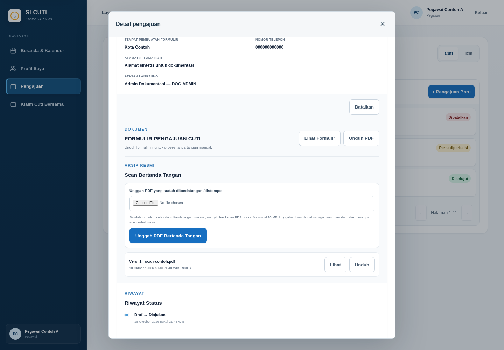

_Gambar 19. Formulir awal dan daftar versi scan._

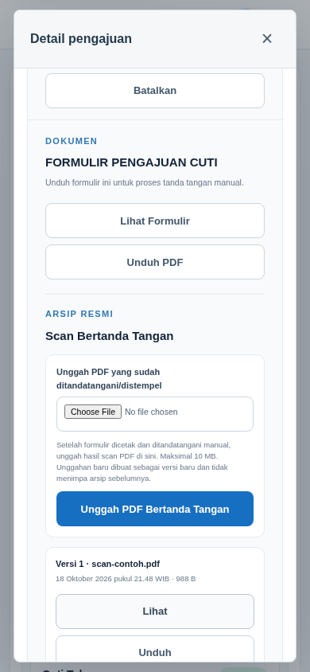

_Gambar 20. Upload PDF scan pada ponsel._

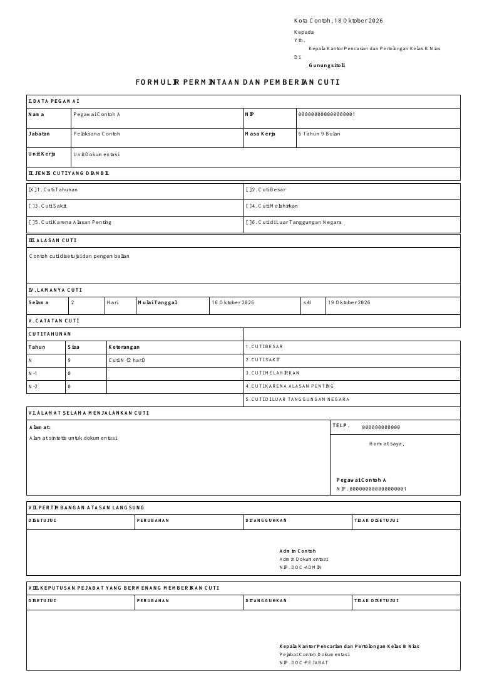

_Gambar 21. Render halaman pertama PDF formulir-awal asli keluaran aplikasi; data sintetis._

### 5.2 Membaca keputusan dan mengunduh PDF final

**Kegunaan/menu.** Buka pengajuan **Disetujui** atau **Ditolak**, kemudian **Arsip Hasil Keputusan**. Siapkan sesi aktif dan periksa identitas, revisi serta scan sumber.

1. Baca status, alasan/dasar dan sumber arsip.
2. Pilih **Unduh PDF Keputusan Final** untuk persetujuan atau **Unduh Hasil Penolakan** untuk penolakan ketika berkas sudah tersedia.
3. Periksa daftar unduhan browser/perangkat dan buka file hasilnya.

**Hasil.** Arsip keputusan adalah dokumen turunan yang menggabungkan catatan status dan sumber yang dipilih; scan asli tetap terpisah. Penolakan tanpa scan dapat mempunyai pemberitahuan penolakan. **Jika berkas belum siap atau sesi berakhir**, ikuti pesan, login ulang atau hubungi Admin; jangan menganggap tombol yang ditekan membuktikan file sudah tersimpan di perangkat.

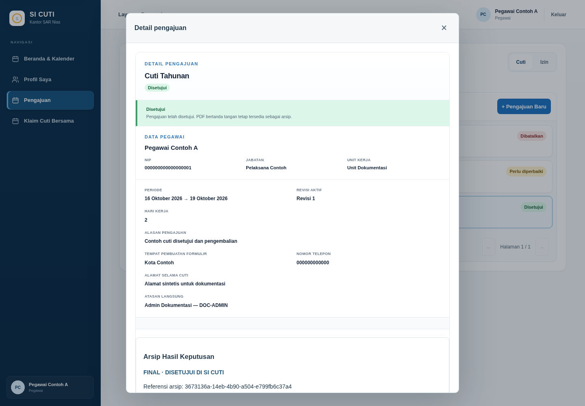

_Gambar 22. Detail disetujui._

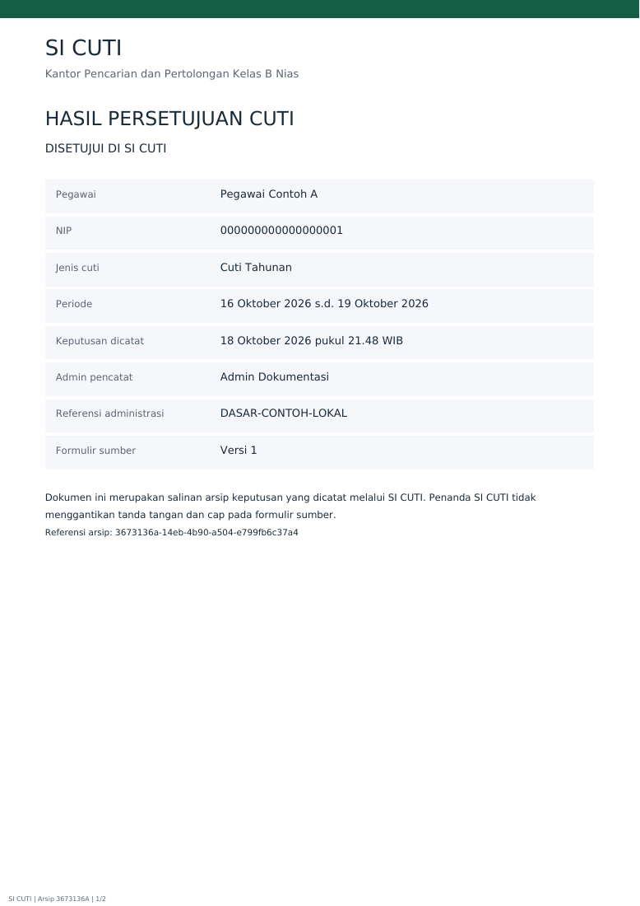

_Gambar 23. Render halaman pertama PDF keputusan-final asli keluaran aplikasi; data sintetis._

Penanda SI CUTI bukan tanda tangan elektronik tersertifikasi, cap resmi baru, atau nomor surat baru. Edisi penanda tidak mengganti scan asli. Identitas/periode di snapshot arsip lama tidak otomatis berubah ketika master pegawai atau pejabat diedit.

### 5.3 Membaca pengembalian saldo

**Kegunaan/menu.** Lihat **Pengembalian Cuti** dalam detail Cuti Tahunan yang disetujui. Tidak ada tombol Pegawai untuk membuat kompensasi ini; siapkan dasar/bukti untuk dikonsultasikan kepada Admin.

1. Baca jumlah, waktu pencatatan, alasan dan referensi dasar.
2. Buka bukti yang terkait bila perlu.
3. Cocokkan perubahan saldo melalui beranda; minta klarifikasi Admin bila tidak sesuai.

**Hasil.** Pengajuan tetap **Disetujui**; pengembalian tercatat sebagai kompensasi terpisah. **Jika tidak ada histori**, itu bukan otomatis kegagalan sistem—mungkin belum dicatat atau belum memenuhi pemeriksaan. Jumlah hari dikembalikan tidak menentukan tanggal penggunaan aktual dan tidak memendekkan periode kalender.

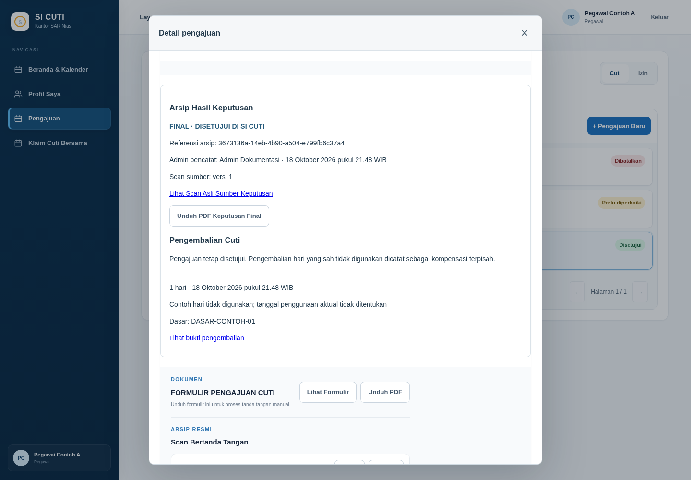

_Gambar 24. Arsip keputusan dan pengembalian._

## 6. Izin

**Kegunaan/menu.** Pilih **Ajukan Izin** atau **Pengajuan → Izin → + Pengajuan Baru**. Izin terpisah dari Cuti dan tidak mengurangi saldo Cuti Tahunan. Siapkan jenis izin aktif, tanggal dan alasan.

1. Pilih jenis izin yang tersedia; nama “Izin Contoh Dokumentasi” pada gambar hanya fixture lokal, bukan jenis resmi yang ditetapkan panduan.
2. Isi tanggal dan alasan, simpan draf.
3. Buka detail, periksa lalu **Ajukan Sekarang**.
4. Tindak lanjuti koreksi/penolakan/persetujuan berdasarkan status dan catatan Admin, dengan perbedaan yang sama seperti Bab 4.

**Hasil.** Pengajuan tersimpan pada tab Izin dan kalender/agenda Izin, bukan tab Cuti. **Jika jenis masih loading/gagal**, tunggu atau gunakan tombol muat ulang. Jika tidak ada jenis aktif, simpan dinonaktifkan: hubungi Admin; jangan memilih jenis cuti sebagai pengganti.

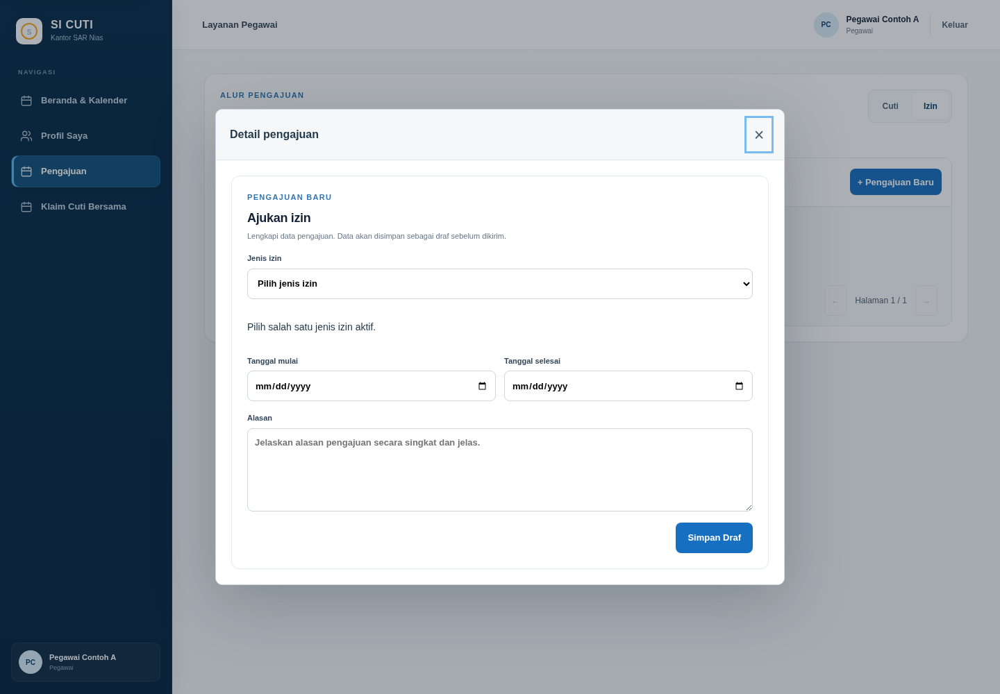

_Gambar 25. Jenis izin fixture aktif; bukan daftar resmi._

Pada versi ini form Izin menyediakan jenis, tanggal dan alasan; alur formulir/scan/PDF keputusan dan pengembalian saldo dalam Bab 5 adalah untuk Cuti. Jangan mengasumsikan semua tombol dokumen Cuti tersedia di Izin. Tidak ada menu Pegawai untuk membuat jenis izin sendiri.

## 7. Klaim Cuti Bersama

**Batas pembuktian penting.** Menu dan komponen klaim tersedia pada sumber. Namun pengujian lokal buku ini mendapati HTTP 500 pada endpoint koleksi/kebijakan klaim. Gambar berikut menunjukkan kondisi aktual, **bukan alur klaim yang sudah lulus**. Status tersimpan/review/sebagian/duplikasi belum berhasil diambil sebagai screenshot nyata. Lihat reproduksi di checkpoint; tidak memakai mock untuk menggantinya.

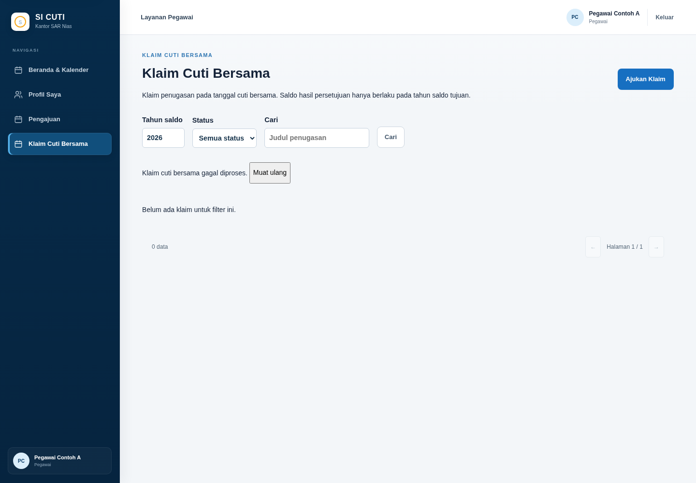

_Gambar 26. Kondisi aktual: endpoint koleksi gagal, bukan daftar kosong yang sah._

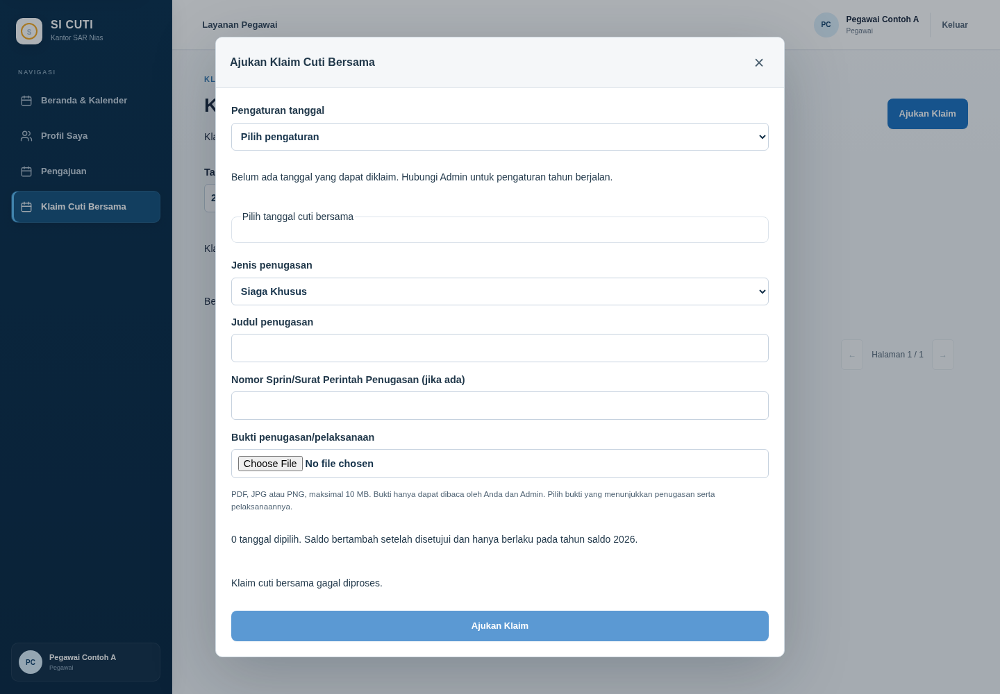

_Gambar 27. Form klaim dan kendala memuat kebijakan._

**Tujuan/menu/prasyarat.** Klaim digunakan untuk bukti penugasan pada tanggal Cuti Bersama sesuai pengaturan Admin yang sah. Buka **Klaim Cuti Bersama**, siapkan tanggal kebijakan, jenis/judul penugasan, Sprin bila relevan dan bukti PDF/JPEG/PNG maksimal 10 MB.

**Urutan menurut komponen dan service yang tersedia, belum diverifikasi end-to-end pada task ini:**

1. Pilih **Ajukan Klaim**, kebijakan/tanggal yang tersedia dan isi penugasan.
2. Unggah bukti, periksa isian dan kirim sekali.
3. Periksa daftar serta detail untuk hasil pemeriksaan per tanggal; persetujuan dapat sebagian.
4. Tanggal yang masih aktif/sudah disetujui dapat diblokir sebagai duplikasi; jangan membuat klaim berulang untuk mengatasi pesan tersebut.

**Hasil yang dirancang kode.** Klaim disetujui menambah bucket **Klaim Cuti Bersama** pada tahun saldo tujuan sesuai batas kebijakan, bukan bukti pegawai sedang cuti. **Pada kondisi error saat buku dibuat**, hentikan pengiriman berulang dan laporkan ke Admin beserta waktu/menu/pesan tanpa password atau bukti sensitif. Jangan menganggap daftar gagal dimuat berarti tidak pernah ada klaim.

Saldo klaim, Cuti N/N-1/N-2 dan overlay tanggal adalah hal berbeda. Tanggal atau kuota contoh pada fixture bukan dasar hukum dan tidak boleh disalin ke lingkungan instansi.

## 8. Profil dan foto sendiri

**Kegunaan/menu.** Buka **Profil Saya** atau avatar. Data master dibaca dari akun sendiri; hubungi Admin untuk koreksi NIP/nama/jabatan/unit, bukan mengubah arsip lama. Siapkan JPEG/PNG maksimal 5 MiB untuk foto; SVG, URL eksternal, animasi dan file rusak tidak diterima.

1. Tekan **Pilih foto** atau **Ganti foto**, pilih gambar.
2. Periksa pratinjau. Pada tahap ini gambar belum tersimpan di server.
3. Tekan **Simpan foto**, tunggu pesan tersimpan; header/sidebar/profil diperbarui tanpa logout.
4. Untuk menghapus, tekan **Hapus foto**, baca konfirmasi, kemudian **Ya, hapus foto**. Escape membatalkan konfirmasi.
5. Jika gambar gagal dimuat, inisial dipakai; gunakan **Muat ulang foto** bila perlu.

**Hasil.** Gambar dinormalisasi hingga maksimal 512×512 dengan rasio terjaga. Tidak ada crop editor. Foto hanya untuk akun sendiri dan tidak masuk formulir/PDF/laporan/snapshot. **Jika unggah/ganti gagal**, periksa format/ukuran dan ulangi sesuai pesan; foto lama dipertahankan. Bila ada perubahan bersamaan, muat ulang sebelum menyimpan lagi.

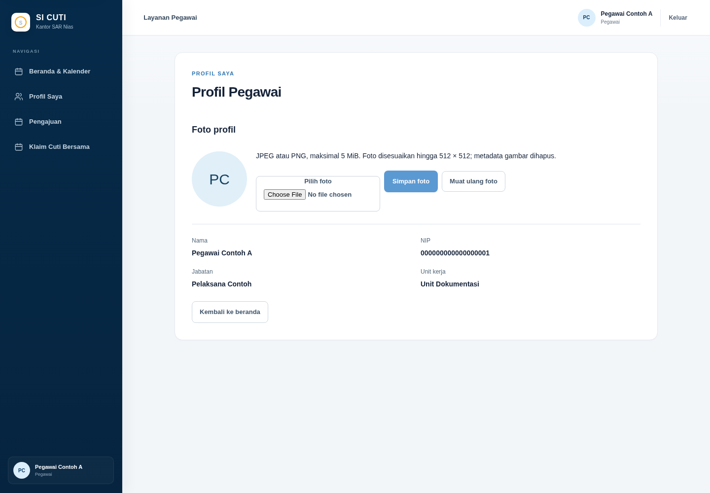

_Gambar 28. Profil sendiri dengan fallback inisial._

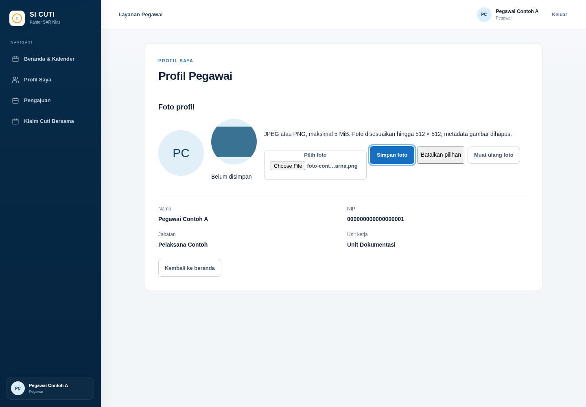

_Gambar 29. Preview foto sintetis lokal belum disimpan._

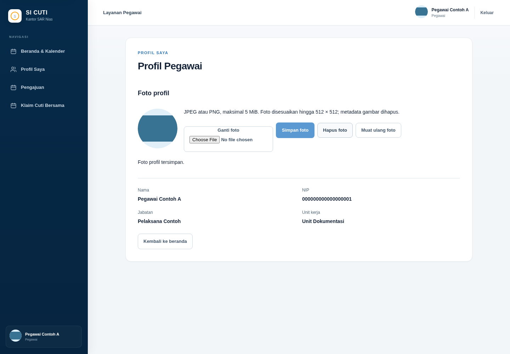

_Gambar 30. Foto diri sendiri tersimpan, header/sidebar diperbarui._

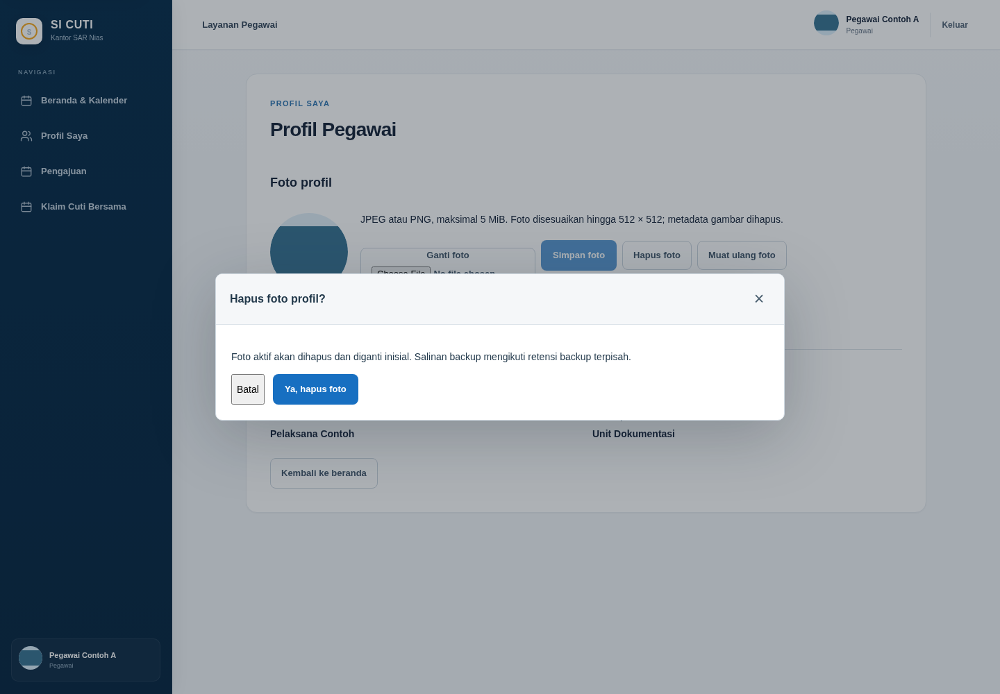

_Gambar 31. Konfirmasi hapus foto sendiri._

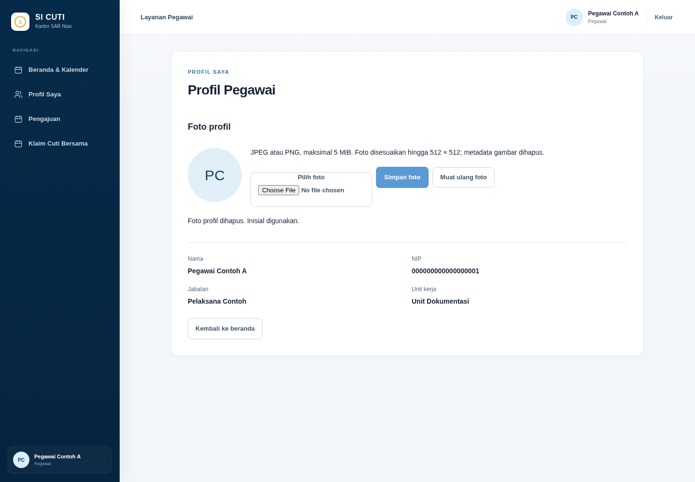

_Gambar 32. Foto dihapus; inisial dipakai kembali._

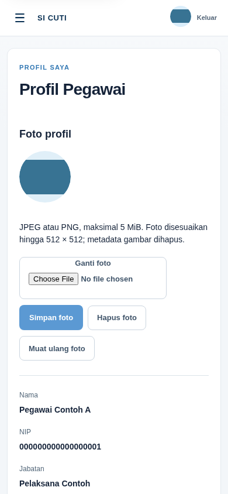

_Gambar 33. Viewport 390×844; data sendiri._

Penghapusan aktif tidak berarti semua backup/salinan perangkat langsung hilang. UI Pegawai tidak menyediakan foto orang lain, direktori foto, atau penggantian foto oleh Admin.

## 9. Masalah umum dan glosarium

| Yang terlihat                                       | Tindakan yang tepat                                                                                |
| --------------------------------------------------- | -------------------------------------------------------------------------------------------------- |
| Sesi berakhir atau akses ditolak                    | Masuk ulang; jangan meminjam akun/tautan milik pegawai lain.                                       |
| Loading/gagal memuat                                | Tunggu atau Coba lagi. Data gagal dimuat bukan angka nol.                                          |
| Saldo belum disiapkan/PARTIAL                       | Hubungi Admin; jangan mengisi sendiri nilai saldo.                                                 |
| Draf tersimpan tetapi Admin belum melihat pengajuan | Buka detail dan lakukan Ajukan Sekarang setelah memeriksa data.                                    |
| Ditolak                                             | Baca alasan; record final tidak dibuka ulang, pengajuan berikutnya memakai record baru.            |
| Scan tidak bisa diunggah                            | Periksa status Diajukan, revisi, PDF asli dan batas ukuran.                                        |
| Browser mulai mengunduh tetapi file tidak terlihat  | Periksa daftar unduhan/folder/izin perangkat, lalu ulangi melalui sesi yang sah bila perlu.        |
| Klaim gagal dimuat                                  | Ada kendala lokal tercatat; jangan mengirim berulang atau menafsirkan error sebagai daftar kosong. |

**Glosarium.** Draf: belum dikirim. Revisi: versi isi permohonan. Diajukan: sudah dikirim untuk tinjauan. Perlu diperbaiki: kembali untuk diperbaiki, bukan keputusan final. Disetujui/Ditolak: hasil final record. Dibatalkan: dihentikan sebelum final tanpa menghapus histori. Cadangan: bagian saldo yang ditahan pengajuan. Snapshot: salinan data pada peristiwa tertentu. Scan asli: file bukti unggahan. PDF keputusan: turunan arsip hasil keputusan. Overlay: lapisan tanggal informasi, bukan kalender kerja penghitung hari.

Notifikasi pada panduan adalah pesan di layar. Buku ini tidak menyatakan reminder otomatis, log login yang dapat dibuka pengguna, atau laporan lanjutan tersedia.
